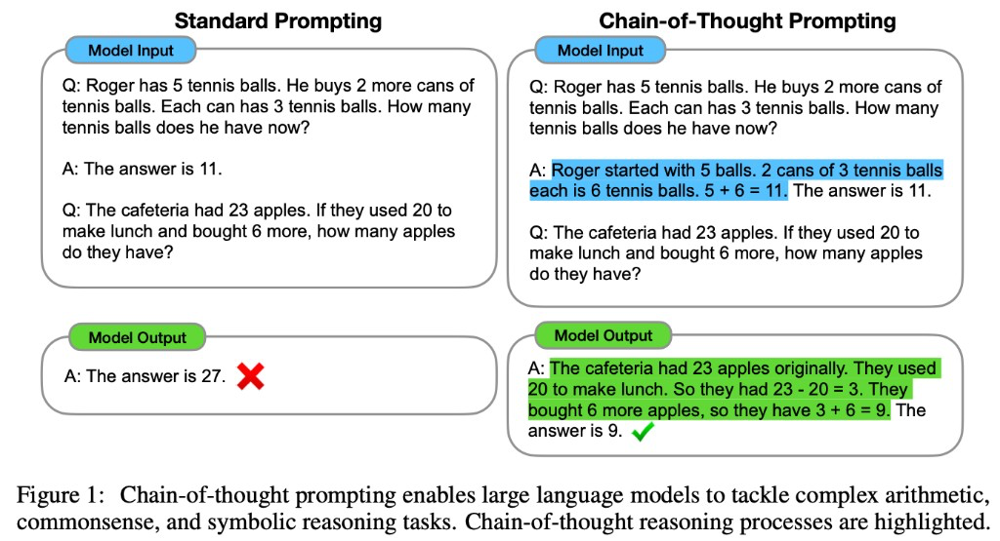
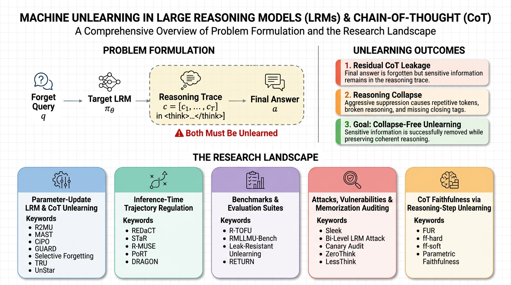

# Awesome LRM Unlearning

<p align="center">
  <a href="https://awesome.re"></a>
  <a href="https://github.com/guts-yang/awesome-lrm-unlearning/commits"></a>
  <a href="https://github.com/guts-yang/awesome-lrm-unlearning/blob/main/LICENSE"></a>
</p>

A curated collection of papers, benchmarks, datasets, evaluation metrics, and open-source frameworks for Machine Unlearning in Large Reasoning Models (LRMs) and Chain-of-Thought (CoT) Reasoning.

As of the latest update, this repository curates **19** core papers, **7** benchmarks and evaluation suites, **12** LRM-specific evaluation metrics, and **8** open-source codebases and project portals.

> **Scope & Contributions:** This list strictly focuses on machine unlearning where **multi-step Chain-of-Thought (CoT) reasoning traces**, **thinking trajectories (`<think>...</think>`)**, or **Large Reasoning Models (LRMs)** are first-class objects of study. If your paper, benchmark, or codebase fits this scope, please open an [Issue](../../issues) or submit a [Pull Request](CONTRIBUTING.md)!

## Contents

- [Overview: Why LRM & CoT Unlearning?](#overview-why-lrm--cot-unlearning)
- [News & Highlights](#news--highlights)
- [Papers by Research Taxonomy](#papers-by-research-taxonomy)
  - [1. Parameter-Update LRM & CoT Unlearning](#1-parameter-update-lrm--cot-unlearning)
  - [2. Inference-Time & Training-Free Trajectory Regulation](#2-inference-time--training-free-trajectory-regulation)
  - [3. Benchmarks & Holistic Evaluation Suites](#3-benchmarks--holistic-evaluation-suites)
  - [4. Attacks, Vulnerabilities & Memorization Auditing](#4-attacks-vulnerabilities--memorization-auditing)
  - [5. CoT Faithfulness via Reasoning-Step Unlearning](#5-cot-faithfulness-via-reasoning-step-unlearning)
- [Papers by Chronological Order](#papers-by-chronological-order)
  - [2026](#2026)
  - [2025](#2025)
  - [2024](#2024)
- [Benchmarks & Evaluation Suites](#benchmarks--evaluation-suites)
- [Evaluation Metrics for LRM & CoT Unlearning](#evaluation-metrics-for-lrm--cot-unlearning)
- [Open-Source Frameworks & Portals](#open-source-frameworks--portals)
- [Contributing](#contributing)
- [Citation](#citation)

## Overview: Why LRM & CoT Unlearning?

Conventional LLM unlearning operates on direct input-output mappings $q \to a$, optimizing forget and retain losses solely over final answers. In contrast, **Large Reasoning Models (LRMs)**—such as OpenAI o1/o3-style models, DeepSeek-R1 and its distilled variants, QwQ, RLVR-trained checkpoints, and Reasoning MLLMs—explicitly generate an intermediate **Chain-of-Thought (CoT)** [Chain-of-Thought Prompting](https://arxiv.org/abs/2201.11903) ([GitHub](https://github.com/jasonwei20/chain-of-thought-prompting)) trajectory $c = [c_1, \dots, c_T]$ (typically enclosed in `<think>...</think>`) before emitting a final answer $a$:

$$\pi_{\theta}(c, a \mid q) = \pi_{\theta}(c \mid q)\,\pi_{\theta}(a \mid q, c)$$

<p align="center">
  
  <br>
  <em>Figure 1 from <a href="https://arxiv.org/abs/2201.11903">Wei et al., Chain-of-Thought Prompting Elicits Reasoning in Large Language Models</a>.</em>
</p>

Applying answer-centric unlearning to LRMs exposes a fundamental **forgetting–reasoning dilemma**:

1. **Residual CoT Leakage:** Erasing or refusing only at the final answer $a$ leaves sensitive, private, or hazardous knowledge intact within intermediate reasoning steps $c$, allowing trivial extraction or answer reconstruction.
2. **Reasoning Collapse:** Aggressively perturbing weights or hidden representations over long reasoning chains destabilizes multi-step deduction, causes repetitive token loops, suppresses closing `</think>` delimiters, or degrades general STEM reasoning (`AIME`, `MATH-500`, `GPQA`).
3. **Decoding & Reasoning-Path Bypass:** Constrained decoding modes (`ZeroThink`, `LessThink`), multi-hop logical paths, and step-by-step reasoning attacks can resurface superficially suppressed knowledge.

<p align="center">
  
</p>

## News & Highlights

- **`[2026-11]`** Initial release of **Awesome LRM Unlearning**, unifying taxonomy-structured comparisons, chronological tracking, LRM-specific benchmarks, and CoT evaluation metrics.
- **`[2026-10]`** **REDaCT** (*Findings of EMNLP 2026*) introduces collapse-free inference-time sentence-level leak detection and corrective embedding injection inside CoT traces.
- **`[2026-09]`** **GUARD** proposes Guided Answer-Reasoning Distillation for natural safe-exit CoT trajectories and introduces the Natural Forgetting Reasoning Score (`NFRS`).
- **`[2026-07]`** **CiPO** (*ACL 2026*) formulates causal counterfactual CoT preference optimization for LRMs; **R-MUSE / RMLLMU-Bench** (*CVPR 2026*) extends reasoning-preserving unlearning to Multimodal LRMs.
- **`[2025-11]`** Landmark *EMNLP 2025* trio establishes the sub-field: **R-TOFU** (first LRM unlearning benchmark + `Reasoned IDK`), **R2MU** (reasoning-aware representation misdirection), and **FUR** (parametric CoT faithfulness via step unlearning).

---

## Papers by Research Taxonomy

A taxonomy-organized comparison of LRM and CoT machine unlearning literature. Works spanning multiple pillars (e.g., introducing both a benchmark and an unlearning algorithm) are cross-referenced with `†`.

### 1. Parameter-Update LRM & CoT Unlearning

Training-time unlearning algorithms that update model weights or hidden-state representations to erase forget-set knowledge from both intermediate Chain-of-Thought (CoT) trajectories and final answers, via representation misdirection, mechanism-guided subspace targeting, counterfactual reasoning preference optimization, or guided reasoning distillation.

| **Paper Title** | **Date** | **Author(s)** | **Venue** | **Method** | **Stage** | **Target Scope** | **Code / Portal** |
| :--- | :---: | :--- | :---: | :---: | :---: | :---: | :---: |
| [GUARD: Natural Forgetting in Large Reasoning Models via Guided Answer-Reasoning Distillation](https://arxiv.org/abs/2609.21677) | 2026-09 | Yan et al. | *arXiv* | `GUARD` | Training-Time | CoT + Answer | [](https://github.com/zeyu-Yan/GUARD) |
| [Mechanism-Guided Selective Unlearning for RLVR-Induced Reasoning](https://arxiv.org/abs/2606.19222) | 2026-06 | Zhou et al. | *arXiv* | `MAST` | Training-Time | RLVR Reasoning Trajectories | - |
| [CiPO: Counterfactual Unlearning for Large Reasoning Models through Iterative Preference Optimization](https://arxiv.org/abs/2604.15847) | 2026-04 | Li et al. | *ACL 2026* | `CiPO` | Training-Time | CoT + Answer | [](https://github.com/TerryLee77/CiPO) |
| [Selective Forgetting for Large Reasoning Models](https://arxiv.org/abs/2604.03571) | 2026-04 | Le et al. | *arXiv* | `Selective LRM Forgetting` | Training-Time | CoT Segments + Answer | - |
| [Explainable LLM Unlearning Through Reasoning](https://arxiv.org/abs/2603.09980) | 2026-03 | Liao et al. | *arXiv* | `TRU` | Training-Time | Reasoning Target + Answer | - |
| [Rethinking Unlearning for Large Reasoning Models](https://openreview.net/forum?id=jyzjeLq7K3) | 2025-06 | Wang et al. | *ICML 2025 MUGen Workshop* | `R2MU (Workshop)` | Training-Time | CoT + Answer | [](https://github.com/OPTML-Group/Unlearn-R2MU) |
| [Reasoning Model Unlearning: Forgetting Traces, Not Just Answers, While Preserving Reasoning Skills](https://arxiv.org/abs/2506.12963) | 2025-06 | Wang et al. | *EMNLP 2025* | `R2MU` | Training-Time | CoT + Answer | [](https://github.com/OPTML-Group/Unlearn-R2MU) |
| [R-TOFU: Unlearning in Large Reasoning Models](https://arxiv.org/abs/2505.15214) † | 2025-05 | Yoon et al. | *EMNLP 2025* | `R-TOFU / Reasoned IDK` | Benchmark & Training-Time | CoT + Answer | [](https://ai-isl.github.io/r-tofu) |
| [UnStar: Unlearning with Self-Taught Anti-Sample Reasoning for LLMs](https://arxiv.org/abs/2410.17050) | 2024-10 | Sinha et al. | *TMLR 2025* | `UnStar` | Training-Time | Anti-Sample Rationales + Answer | [](https://github.com/MachineUnlearn/UnStar) |

### 2. Inference-Time & Training-Free Trajectory Regulation

Parameter-preserving interventions that monitor, steer, truncate-and-regenerate, or self-correct multi-step reasoning traces during decoding to prevent sensitive CoT disclosure while completely avoiding weight-induced reasoning collapse.

| **Paper Title** | **Date** | **Author(s)** | **Venue** | **Method** | **Stage** | **Target Scope** | **Code / Portal** |
| :--- | :---: | :--- | :---: | :---: | :---: | :---: | :---: |
| [REDaCT: Collapse-Free Unlearning in Large Reasoning Models](https://arxiv.org/abs/2610.12769) | 2026-10 | Maccoby & Wang | *Findings of EMNLP 2026* | `REDaCT` | Inference-Time | CoT + Answer | [](https://github.com/jmaccoby/redact) |
| [STaR: Sensitive Trajectory Regulation for Unlearning in Large Reasoning Models](https://arxiv.org/abs/2601.09281) | 2026-01 | Zhou et al. | *arXiv* | `STaR` | Inference-Time | CoT + Answer | - |
| [Robust LLM Unlearning via Post Judgment and Multi-round Thinking](https://openreview.net/forum?id=GBTUVO9vkj) | 2026-01 | Chen et al. | *ICLR 2026* | `PoRT` | Inference-Time | Multi-Round Thinking + Answer | [](https://github.com/ChnIRuI/PoRT_LLM_Unlearning) |
| [DRAGON: Guard LLM Unlearning in Context via Negative Detection and Reasoning](https://arxiv.org/abs/2511.05784) | 2025-11 | Wang et al. | *arXiv* | `DRAGON` | Inference-Time | In-Context CoT + Answer | - |
| [Towards Reasoning-Preserving Unlearning in Multimodal Large Language Models](https://arxiv.org/abs/2512.17911) | 2025-11 | Li et al. | *CVPR 2026* | `R-MUSE / RMLLMU-Bench` | Inference-Time & Benchmark | Multimodal CoT + Answer | - |

### 3. Benchmarks & Holistic Evaluation Suites

Dedicated benchmarks and CoT-annotated datasets designed to measure step-level reasoning leakage, answer forgetting, multi-hop reasoning consistency, multimodal reasoning retention, and decoding-variant robustness.

| **Paper Title** | **Date** | **Author(s)** | **Venue** | **Method** | **Stage** | **Target Scope** | **Code / Portal** |
| :--- | :---: | :--- | :---: | :---: | :---: | :---: | :---: |
| [Leak-Resistant Unlearning: A New Benchmark for Evaluating Multi-Hop Reasoning Consistency and Recovery Robustness](https://arxiv.org/abs/2608.04519) | 2026-08 | Qian et al. | *arXiv* | `Leak-Resistant Bench` | Benchmark | Multi-Hop Reasoning Paths | [](https://leak-resistant.site) |
| [Towards Reasoning-Preserving Unlearning in Multimodal Large Language Models](https://arxiv.org/abs/2512.17911) † | 2025-11 | Li et al. | *CVPR 2026* | `R-MUSE / RMLLMU-Bench` | Inference-Time & Benchmark | Multimodal CoT + Answer | - |
| [R-TOFU: Unlearning in Large Reasoning Models](https://arxiv.org/abs/2505.15214) | 2025-05 | Yoon et al. | *EMNLP 2025* | `R-TOFU / Reasoned IDK` | Benchmark & Training-Time | CoT + Answer | [](https://ai-isl.github.io/r-tofu) |

### 4. Attacks, Vulnerabilities & Memorization Auditing

Adversarial studies and construct-validity audits showing how step-by-step reasoning prompts extract superficially erased knowledge, how malicious unlearning requests manipulate LRM rationales, and how parser-split CoT audits can be confounded by template drift.

| **Paper Title** | **Date** | **Author(s)** | **Venue** | **Method** | **Stage** | **Target Scope** | **Code / Portal** |
| :--- | :---: | :--- | :---: | :---: | :---: | :---: | :---: |
| [Auditing Reasoning-Trace Memorization Claims after Unlearning with Head-Conditioned Canaries](https://arxiv.org/abs/2605.18891) | 2026-05 | Li et al. | *arXiv* | `Canary Prefill Audit` | Audit / Evaluation | CoT + Answer | - |
| [Towards Unveiling Vulnerabilities of Large Reasoning Models in Machine Unlearning](https://arxiv.org/abs/2604.04255) | 2026-04 | Chen et al. | *arXiv* | `Bi-Level LRM Unlearning Attack` | Attack | CoT + Answer | - |
| [Step-by-Step Reasoning Attack: Revealing 'Erased' Knowledge in Large Language Models](https://arxiv.org/abs/2506.17279) | 2025-06 | Sinha et al. | *arXiv* | `Sleek` | Attack | CoT Extraction | - |

### 5. CoT Faithfulness via Reasoning-Step Unlearning

Mechanistic frameworks that selectively unlearn individual verbalized CoT steps from model parameters to test whether generated reasoning chains faithfully reflect internal parametric computations.

| **Paper Title** | **Date** | **Author(s)** | **Venue** | **Method** | **Stage** | **Target Scope** | **Code / Portal** |
| :--- | :---: | :--- | :---: | :---: | :---: | :---: | :---: |
| [Measuring Chain of Thought Faithfulness by Unlearning Reasoning Steps](https://arxiv.org/abs/2502.14829) | 2025-02 | Tutek et al. | *EMNLP 2025* | `FUR` | Training-Time Audit | Individual CoT Steps | [](https://github.com/technion-cs-nlp/parametric-faithfulness) |

---

## Papers by Chronological Order

Complete bibliographic entries sorted in reverse chronological order (`YYYY-MM`).

### 2026

- [REDaCT: Collapse-Free Unlearning in Large Reasoning Models](https://arxiv.org/abs/2610.12769)
  - Author(s): Joshua Maccoby, Wendy Hui Wang
  - Date: 2026-10
  - Venue: Findings of EMNLP 2026
  - Category: Inference-Time Regulation (`CoT + Answer`)
  - Evaluated Backbones: DeepSeek-R1-Distill-Llama-8B, DeepSeek-R1-Distill-Qwen-7B
  - Summary: Detects forget-set leaks sentence-by-sentence inside CoT traces and injects an offline-learned corrective embedding to regenerate safe continuations with zero reasoning collapse.
  - Code: [](https://github.com/jmaccoby/redact)
- [GUARD: Natural Forgetting in Large Reasoning Models via Guided Answer-Reasoning Distillation](https://arxiv.org/abs/2609.21677)
  - Author(s): Zeyu Yan, Guanghao Zhou, Minghui Qiu, Ming Gao, Cen Chen
  - Date: 2026-09
  - Venue: -
  - Category: Parameter-Update Unlearning (`CoT + Answer`)
  - Evaluated Backbones: DeepSeek-R1-Distill-Llama-8B, DeepSeek-R1-Distill-Qwen-7B
  - Summary: Converts unsafe or private CoT disclosures into natural safe-exit trajectories via guidance tokens and distills them into model parameters alongside the NFRS replacement-quality metric.
  - Code: [](https://github.com/zeyu-Yan/GUARD)
- [Leak-Resistant Unlearning: A New Benchmark for Evaluating Multi-Hop Reasoning Consistency and Recovery Robustness](https://arxiv.org/abs/2608.04519)
  - Author(s): Haoting Qian, Qingjie Zhang, Zhicong Huang, Cheng Hong, Han Qiu
  - Date: 2026-08
  - Venue: -
  - Category: Benchmarks & Evaluation (`Multi-Hop Reasoning Paths`)
  - Evaluated Backbones: Llama-3-8B, Qwen2.5-7B, Mistral-7B
  - Summary: Evaluates whether unlearned knowledge remains recoverable across six logic-guided multi-hop reasoning structures combined with prompt-level and parameter-level recovery attacks.
  - Code: [](https://leak-resistant.site)
- [Mechanism-Guided Selective Unlearning for RLVR-Induced Reasoning](https://arxiv.org/abs/2606.19222)
  - Author(s): Chenyu Zhou, Qiliang Jiang, Shuning Wu, Xu Zhou
  - Date: 2026-06
  - Venue: -
  - Category: Parameter-Update Unlearning (`RLVR Reasoning Trajectories`)
  - Evaluated Backbones: Qwen2.5-Math-1.5B, Qwen3-1.7B-Base
  - Summary: Identifies directional mismatch between SFT and RLVR reasoning updates, ranking attention-projection tensors by off-principal energy and forget-gradient coupling to unlearn target math reasoning without collapsing retain skills.
  - Code: -
- [Auditing Reasoning-Trace Memorization Claims after Unlearning with Head-Conditioned Canaries](https://arxiv.org/abs/2605.18891)
  - Author(s): Yanhang Li, Zhichao Fan, Zexin Zhuang
  - Date: 2026-05
  - Venue: -
  - Category: Attacks & Auditing (`CoT + Answer`)
  - Evaluated Backbones: DeepSeek-R1-Distill-Qwen-7B, DeepSeek-R1-Distill-Llama-8B
  - Summary: Audits the parser-split CoT bypass gap on distilled LRMs using six-token canary heads, showing static tag-splitting conflates weight retention with template echo and format drift, and proposes decode-time prefill swaps plus teacher-forced scoring.
  - Code: -
- [CiPO: Counterfactual Unlearning for Large Reasoning Models through Iterative Preference Optimization](https://arxiv.org/abs/2604.15847)
  - Author(s): Junyi Li, Yongqiang Chen, Ningning Ding
  - Date: 2026-04
  - Venue: ACL 2026
  - Category: Parameter-Update Unlearning (`CoT + Answer`)
  - Evaluated Backbones: DeepSeek-R1-Distill-Llama-8B
  - Summary: Formulates LRM unlearning via a causal graph and iteratively pairs self-generated counterfactual CoT-answer trajectories against online-sampled leaking traces using reference-free SimPO.
  - Code: [](https://github.com/TerryLee77/CiPO)
- [Selective Forgetting for Large Reasoning Models](https://arxiv.org/abs/2604.03571)
  - Author(s): Tuan Le, Wei Qian, Mengdi Huai
  - Date: 2026-04
  - Venue: -
  - Category: Parameter-Update Unlearning (`CoT Segments + Answer`)
  - Evaluated Backbones: DeepSeek-R1-Distill-Llama-8B, DeepSeek-R1-Distill-Qwen-7B
  - Summary: Uses RAG-assisted multi-LLM analysis to pinpoint forget-relevant segments within CoT traces, replacing them with logically consistent benign placeholders under a feature-replacement unlearning loss.
  - Code: -
- [Towards Unveiling Vulnerabilities of Large Reasoning Models in Machine Unlearning](https://arxiv.org/abs/2604.04255)
  - Author(s): Aobo Chen, Chenxu Zhao, Chenglin Miao, Mengdi Huai
  - Date: 2026-04
  - Venue: -
  - Category: Attacks & Auditing (`CoT + Answer`)
  - Evaluated Backbones: DeepSeek-R1-Distill-Llama-8B, DeepSeek-R1-Distill-Qwen-7B
  - Summary: Introduces white-box and black-box bi-level malicious unlearning requests that force unlearned LRMs to output incorrect answers supported by coherent, deceptive reasoning traces.
  - Code: -
- [Explainable LLM Unlearning Through Reasoning](https://arxiv.org/abs/2603.09980)
  - Author(s): Junfeng Liao, Qizhou Wang, Shanshan Ye, Xin Yu, Ling Chen, Zhen Fang
  - Date: 2026-03
  - Venue: -
  - Category: Parameter-Update Unlearning (`Reasoning Target + Answer`)
  - Evaluated Backbones: Llama-3-8B-Instruct, Qwen2.5-7B-Instruct
  - Summary: Constructs explicit reasoning-based unlearning targets specifying both unlearning scope and post-unlearning behavior, combining supervised reasoning loss with gradient ascent for explainable and attack-resilient forgetting.
  - Code: -
- [STaR: Sensitive Trajectory Regulation for Unlearning in Large Reasoning Models](https://arxiv.org/abs/2601.09281)
  - Author(s): Jingjing Zhou, Gaoxiang Cong, Li Su, Liang Li
  - Date: 2026-01
  - Venue: -
  - Category: Inference-Time Regulation (`CoT + Answer`)
  - Evaluated Backbones: DeepSeek-R1-Distill-Llama-8B, DeepSeek-R1-Distill-Qwen-7B
  - Summary: Parameter-free inference-time framework combining semantic sensitivity detection, global safety prompt prefixes, trajectory-aware suppression, and token-level adaptive filtering across diverse decoding modes.
  - Code: -
- [Robust LLM Unlearning via Post Judgment and Multi-round Thinking](https://openreview.net/forum?id=GBTUVO9vkj)
  - Author(s): Xinrui Chen, Xu Cao, Jianhao Zhang, Pinlong Zhao, Di Gao, Ou Wu
  - Date: 2026-01
  - Venue: ICLR 2026
  - Category: Inference-Time Regulation (`Multi-Round Thinking + Answer`)
  - Evaluated Backbones: Llama-3-8B-Instruct, Qwen2.5-7B-Instruct
  - Summary: Combines dynamic few-shot query cleaning, joint question-answer post-judgment, and selective multi-round thinking self-correction to defend deployed unlearning systems against prefix and composite reasoning attacks.
  - Code: [](https://github.com/ChnIRuI/PoRT_LLM_Unlearning)

### 2025

- [DRAGON: Guard LLM Unlearning in Context via Negative Detection and Reasoning](https://arxiv.org/abs/2511.05784)
  - Author(s): Yaxuan Wang, Chris Yuhao Liu, Quan Liu, Jinlong Pang, Wei Wei, Yujia Bao, Yang Liu
  - Date: 2025-11
  - Venue: -
  - Category: Inference-Time Regulation (`In-Context CoT + Answer`)
  - Evaluated Backbones: Llama-3-8B-Instruct, Mistral-7B-Instruct
  - Summary: Routes detected forget-worthy prompts without retain data through a dedicated Chain-of-Thought guard model that generates stepwise reasoning instructions for safe in-context unlearning and continual updates.
  - Code: -
- [Towards Reasoning-Preserving Unlearning in Multimodal Large Language Models](https://arxiv.org/abs/2512.17911)
  - Author(s): Hongji Li, Junchi Yao, Manjiang Yu, Priyanka Singh, Xue Li, Di Wang, Lijie Hu
  - Date: 2025-11
  - Venue: CVPR 2026
  - Category: Inference-Time Regulation / Benchmarks & Evaluation (`Multimodal CoT + Answer`)
  - Evaluated Backbones: QvQ-72B-Preview, InternVL2.5-MPO
  - Summary: Introduces RMLLMU-Bench for Reasoning MLLMs alongside R-MUSE, a training-free subspace steering method that suppresses visual-textual CoT leakage while protecting a Reasoning Retain Subspace.
  - Code: -
- [Rethinking Unlearning for Large Reasoning Models](https://openreview.net/forum?id=jyzjeLq7K3)
  - Author(s): Changsheng Wang, Chongyu Fan, Yihua Zhang, Jinghan Jia, Dennis Wei, Parikshit Ram, Nathalie Baracaldo, Sijia Liu
  - Date: 2025-06
  - Venue: ICML 2025 MUGen Workshop
  - Category: Parameter-Update Unlearning (`CoT + Answer`)
  - Evaluated Backbones: DeepSeek-R1-Distill-LLaMA-8B, DeepSeek-R1-Distill-Qwen-14B
  - Summary: Workshop formulation exposing persistent sensitive information leakage inside LRM thinking trajectories under conventional LLM unlearning and motivating reasoning-aware representation misdirection.
  - Code: [](https://github.com/OPTML-Group/Unlearn-R2MU)
- [Reasoning Model Unlearning: Forgetting Traces, Not Just Answers, While Preserving Reasoning Skills](https://arxiv.org/abs/2506.12963)
  - Author(s): Changsheng Wang, Chongyu Fan, Yihua Zhang, Jinghan Jia, Dennis Wei, Parikshit Ram, Nathalie Baracaldo, Sijia Liu
  - Date: 2025-06
  - Venue: EMNLP 2025
  - Category: Parameter-Update Unlearning (`CoT + Answer`)
  - Evaluated Backbones: DeepSeek-R1-Distill-LLaMA-8B, DeepSeek-R1-Distill-Qwen-14B
  - Summary: First systematic study of LRM unlearning; proposes an 'unthinking' representation misdirection loss over elicited CoT segments paired with LIMO CoT representation alignment to preserve reasoning ability.
  - Code: [](https://github.com/OPTML-Group/Unlearn-R2MU)
- [Step-by-Step Reasoning Attack: Revealing 'Erased' Knowledge in Large Language Models](https://arxiv.org/abs/2506.17279)
  - Author(s): Yash Sinha, Manit Baser, Murari Mandal, Dinil Mon Divakaran, Mohan Kankanhalli
  - Date: 2025-06
  - Venue: -
  - Category: Attacks & Auditing (`CoT Extraction`)
  - Evaluated Backbones: Llama-2-7B, Mistral-7B
  - Summary: Demonstrates that step-by-step CoT reasoning acts as a black-box backdoor (`Sleek`) to reconstruct superficially erased facts across direct, implied, and indirect multi-step prompts.
  - Code: -
- [R-TOFU: Unlearning in Large Reasoning Models](https://arxiv.org/abs/2505.15214)
  - Author(s): Sangyeon Yoon, Wonje Jeung, Albert No
  - Date: 2025-05
  - Venue: EMNLP 2025
  - Category: Benchmarks & Evaluation / Parameter-Update Unlearning (`CoT + Answer`)
  - Evaluated Backbones: DeepSeek-R1-Distill-Llama-8B, DeepSeek-R1-Distill-Qwen-7B, DeepSeek-R1-Distill-Qwen-14B
  - Summary: Establishes the first LRM unlearning benchmark with aligned CoT annotations and step-wise metrics (`CFE`, `AFE`), proposes `Reasoned IDK` preference tuning, and uncovers `ZeroThink`/`LessThink` decoding leakage.
  - Code: [](https://ai-isl.github.io/r-tofu)
- [Measuring Chain of Thought Faithfulness by Unlearning Reasoning Steps](https://arxiv.org/abs/2502.14829)
  - Author(s): Martin Tutek, Fateme Hashemi Chaleshtori, Ana Marasovic, Yonatan Belinkov
  - Date: 2025-02
  - Venue: EMNLP 2025
  - Category: CoT Faithfulness (`Individual CoT Steps`)
  - Evaluated Backbones: Llama-3-8B-Instruct, Mistral-7B-Instruct, OLMo-7B-Instruct, Zephyr-7B
  - Summary: Erases parametric knowledge encoded in individual CoT steps via KL-regularized NPO (`FUR`) and measures resulting prediction shifts (`ff-hard`, `ff-soft`) to test parametric CoT faithfulness.
  - Code: [](https://github.com/technion-cs-nlp/parametric-faithfulness)

### 2024

- [UnStar: Unlearning with Self-Taught Anti-Sample Reasoning for LLMs](https://arxiv.org/abs/2410.17050)
  - Author(s): Yash Sinha, Murari Mandal, Mohan Kankanhalli
  - Date: 2024-10
  - Venue: TMLR 2025
  - Category: Parameter-Update Unlearning (`Anti-Sample Rationales + Answer`)
  - Evaluated Backbones: Llama-2-7B, Mistral-7B
  - Summary: Pioneers self-taught anti-sample reasoning—generating falsified answers backed by misleading step-by-step rationales—to selectively reverse target parametric associations without harming neighboring facts.
  - Code: [](https://github.com/MachineUnlearn/UnStar)

---

## Benchmarks & Evaluation Suites

| **Benchmark / Dataset** | **Category** | **Scale & Splits** | **Modality** | **Evaluation Focus** | **Links** |
| :--- | :--- | :--- | :---: | :--- | :---: |
| **R-TOFU (Reasoning-TOFU)** | Dedicated LRM Unlearning | 4,000 QA + Aligned CoTs (200 fictitious authors; forget01 / forget05 / forget10) | Text (CoT + Answer) | Entity privacy unlearning across intermediate CoT steps and final answers, plus ZeroThink/LessThink decoding robustness. | [[Resource]](https://ai-isl.github.io/r-tofu) [[Paper]](https://arxiv.org/abs/2505.15214) |
| **RMLLMU-Bench** | Dedicated Multimodal LRM Unlearning | Multi-split Forget / Retain / Celebrity & General VQA with Visual CoTs | Image + Text (Multimodal CoT) | Jointly evaluates visual-textual reasoning leakage (`RIL`), answer forgetting, and general multimodal reasoning retention. | [[Paper]](https://arxiv.org/abs/2512.17911) |
| **Leak-Resistant Unlearning Benchmark** | Multi-Hop Reasoning & Recovery | 6 logic-guided multi-hop reasoning structures across 2 curated datasets | Text (Multi-Hop Reasoning) | Measures indirect knowledge leakage via multi-hop logical paths and post-unlearning prompt/parameter recovery attacks. | [[Resource]](https://leak-resistant.site) [[Paper]](https://arxiv.org/abs/2608.04519) |
| **RETURN (Real-World LRM Memorization Split)** | Real-World LRM Privacy Unlearning | 260 deeply memorized public-figure QA pairs (50% Forget / 50% Retain) | Text (Native LRM CoT + Answer) | Evaluates unlearning of naturally memorized real-world PII in native DeepSeek-R1-Distill CoT trajectories rather than synthetic traces. | [[Resource]](https://github.com/TerryLee77/CiPO) [[Paper]](https://arxiv.org/abs/2604.15847) |
| **STAR-1 Harmful-Intent LRM Split** | Safety & Harmful Rationale Unlearning | Curated harmful-intent prompts with safety-aligned vs. unsafe reasoning traces | Text (Safety CoT + Refusal) | Tests whether LRM unlearning replaces unsafe intermediate rationales with coherent safe-exit trajectories without degenerating. | [[Resource]](https://github.com/zeyu-Yan/GUARD) [[Paper]](https://arxiv.org/abs/2609.21677) |
| **WMDP + StrongReject / WildJailbreak / JBB-Behaviors** | Hazardous Knowledge & Safety Suites (Adapted to LRMs) | 3,668 bio/cyber/chem MCQs (WMDP) + adversarial safety prompts | Text (CoT Trace + Answer) | Adopted in R2MU to measure hazardous reasoning trace unlearning (`RT-UA`) alongside final answer suppression (`FA-UA`). | [[Resource]](https://github.com/OPTML-Group/Unlearn-R2MU) [[Paper]](https://arxiv.org/abs/2506.12963) |
| **AIME 2024 / MATH-500 / GPQA Diamond / GSM8K + LIMO** | General Reasoning Preservation & Supervision Suites | Competition math, graduate-level STEM QA, and high-quality CoT supervision triplets | Text (Multi-Step STEM CoT) | Standard utility suites verifying that LRM unlearning does not induce reasoning collapse or degrade test-time scaling competence. | [[Resource]](https://github.com/OPTML-Group/Unlearn-R2MU) [[Paper]](https://arxiv.org/abs/2506.12963) |

---

## Evaluation Metrics for LRM & CoT Unlearning

Unlike standard LLM unlearning, evaluating LRMs requires disentangling **intermediate trace leakage**, **final answer erasure**, **reasoning utility & structural termination**, and **decoding-time robustness**.

### Reasoning-Trace Forgetting Metrics

| **Metric** | **Target Granularity** | **Mechanism / Definition** | **Primary Reference** |
| :--- | :---: | :--- | :--- |
| **CFE (CoT Forgetting Efficacy)** | Step-wise CoT Trace | Aggregates step-level ROUGE recall, step-level cosine similarity, and LLM-as-Judge entailment between generated CoT steps and ground-truth forget facts (higher = stronger trace forgetting). | R-TOFU (Yoon et al., 2025) |
| **RT-UA / CoT-UA (Reasoning Trace Unlearning Accuracy)** | Full CoT Trajectory | Fraction or judge-scored rate at which intermediate `<think>...</think>` trajectories still disclose sensitive or hazardous forget-set knowledge (lower = better forgetting). | R2MU (Wang et al., 2025); CiPO (Li et al., 2026) |
| **RIL (Reasoning Information Leakage)** | Multimodal CoT Process | Quantifies residual target entity/attribute disclosure specifically inside intermediate multimodal reasoning steps on RMLLMU-Bench. | R-MUSE (Li et al., 2025) |

### Answer-Level Forgetting Metrics

| **Metric** | **Target Granularity** | **Mechanism / Definition** | **Primary Reference** |
| :--- | :---: | :--- | :--- |
| **AFE (Answer Forgetting Efficacy)** | Final Answer Span | Complements ROUGE, token probability, truth ratio, and LLM-as-Judge checks on the post-`</think>` final answer span (higher = stronger answer forgetting). | R-TOFU (Yoon et al., 2025) |
| **FA-UA / ForgetACC (Final Answer Unlearning Accuracy)** | Final Answer Span | Task accuracy or factual recall on forget-set queries measured strictly on the final output after reasoning terminates (lower = better forgetting). | R2MU (Wang et al., 2025); CiPO (Li et al., 2026) |

### Reasoning Preservation & Structural Integrity Metrics

| **Metric** | **Target Granularity** | **Mechanism / Definition** | **Primary Reference** |
| :--- | :---: | :--- | :--- |
| **RA (Reasoning Ability)** | General STEM Reasoning | Pass@1 accuracy across held-out multi-step reasoning benchmarks (`AIME 2024`, `MATH-500`, `GPQA Diamond`, `GSM8K`) post-unlearning (higher = better retention). | R2MU (Wang et al., 2025) |
| **Reasoning Collapse Rate / Closing-Delimiter Rate** | CoT Structural Validity | Proportion of responses that degenerate into infinite token loops, gibberish, or fail to emit the closing `</think>` delimiter before token budget exhaustion (0% = collapse-free). | REDaCT (Maccoby & Wang, 2026) |
| **NFRS (Natural Forgetting Reasoning Score)** | Post-Forgetting Trajectory Quality | Evaluates structural boundary stability, fluency, and absence of hallucinated unsupported substitutes in safe-exit CoT trajectories. | GUARD (Yan et al., 2026) |

### Decoding Robustness, Privacy & Faithfulness Audit Metrics

| **Metric** | **Target Granularity** | **Mechanism / Definition** | **Primary Reference** |
| :--- | :---: | :--- | :--- |
| **ZeroThink / LessThink Decoding Leakage** | Constrained-Thinking Decoding | Measures forgotten knowledge resurgence when bypassing (`<think></think>`) or truncating the thinking phase at inference time. | R-TOFU (Yoon et al., 2025) |
| **MCS & Multi-Granularity MIA** | Cross-Decoding & Trace/Answer Privacy | Multi-Decoding Consistency Score (`MCS`) across sampling/thinking modes paired with Membership Inference Attacks at both CoT-chain and answer levels. | STaR (Zhou et al., 2026) |
| **Decode-Time Prefill Swap & Teacher-Forced Canary Probe** | Parser-Split Audit Validity | Pairs fixed non-canary thinking prefills with decoding-free teacher-forced continuation scoring to separate true weight memorization from template echo and format drift. | Canary Audit (Li et al., 2026) |
| **ff-hard & ff-soft (Parametric CoT Faithfulness)** | Individual CoT Step | Measures prediction label flip (`ff-hard`) and target-answer probability drop (`ff-soft`) after unlearning a single CoT step from model parameters. | FUR (Tutek et al., 2025) |

---

## Open-Source Frameworks & Portals

- **[Unlearn-R2MU](https://github.com/OPTML-Group/Unlearn-R2MU)** (EMNLP 2025) — [](https://github.com/OPTML-Group/Unlearn-R2MU)
  - Official codebase for Reasoning-aware Representation Misdirection for Unlearning (`R2MU`) on DeepSeek-R1-Distill models across WMDP and safety/math suites.
- **[R-TOFU Benchmark Suite](https://ai-isl.github.io/r-tofu)** (EMNLP 2025) — [](https://ai-isl.github.io/r-tofu)
  - Benchmark portal, CoT-annotated fictitious-author splits, step-wise `CFE`/`AFE` evaluators, and `Reasoned IDK` / `ZeroThink` / `LessThink` protocols.
- **[CiPO](https://github.com/TerryLee77/CiPO)** (ACL 2026) — [](https://github.com/TerryLee77/CiPO)
  - Counterfactual CoT generator and online iterative SimPO unlearning pipeline evaluated on R-TOFU and real-world RETURN splits.
- **[REDaCT](https://github.com/jmaccoby/redact)** (Findings of EMNLP 2026) — [](https://github.com/jmaccoby/redact)
  - Collapse-free inference-time sentence-level RoBERTa leak detector and corrective embedding optimization for DeepSeek-R1-Distill LRMs.
- **[GUARD](https://github.com/zeyu-Yan/GUARD)** (Preprint 2026) — [](https://github.com/zeyu-Yan/GUARD)
  - Guided Answer-Reasoning Distillation training pipeline and Natural Forgetting Reasoning Score (`NFRS`) evaluation suite.
- **[PoRT](https://github.com/ChnIRuI/PoRT_LLM_Unlearning)** (ICLR 2026) — [](https://github.com/ChnIRuI/PoRT_LLM_Unlearning)
  - Post-judgment and selective multi-round thinking (`SMT`) framework for attack-resilient inference-time unlearning.
- **[Parametric-Faithfulness (FUR)](https://github.com/technion-cs-nlp/parametric-faithfulness)** (EMNLP 2025) — [](https://github.com/technion-cs-nlp/parametric-faithfulness)
  - Step-level CoT unlearning pipeline (`FUR`) and `ff-hard`/`ff-soft` parametric faithfulness evaluators.
- **[UnStar](https://github.com/MachineUnlearn/UnStar)** (TMLR 2025) — [](https://github.com/MachineUnlearn/UnStar)
  - Self-taught anti-sample rationale generation and targeted association unlearning implementation.

---

## Contributing

Contributions are warmly welcome! Please see [CONTRIBUTING.md](CONTRIBUTING.md) for detailed instructions or open a paper submission via our [GitHub Issue Template](../../issues/new/choose).

- **Strict Inclusion Criteria:**
  1. The work must explicitly investigate machine unlearning, selective forgetting, unlearning attacks/audits, or unlearning benchmarks where **intermediate Chain-of-Thought (CoT) reasoning traces**, **thinking trajectories (`<think>...</think>`)**, or **Large Reasoning Models (LRMs / Reasoning MLLMs / RLVR models)** are central to the problem formulation or evaluation.
  2. General LLM unlearning papers that only target final answers without reasoning-trace intervention, reasoning-level leakage analysis, or LRM evaluation are out of scope (for general LLM unlearning, see [chrisliu298/awesome-llm-unlearning](https://github.com/chrisliu298/awesome-llm-unlearning) and [tamlhp/awesome-machine-unlearning](https://github.com/tamlhp/awesome-machine-unlearning)).
- **Quick Update Workflow:**
  ```bash
  # 1. Add or update entries in data/papers.json or data/benchmarks_metrics.json
  # 2. Rebuild README.md and run schema & freshness checks
  python3 scripts/build_readme.py
  python3 scripts/validate_data.py --check-readme
  ```

## Citation

If you find this repository helpful in your research on LRM or CoT unlearning, please consider citing it:

```bibtex
@misc{awesome-lrm-unlearning,
  title        = {{Awesome LRM Unlearning: A Curated List of Chain-of-Thought and Large Reasoning Model Machine Unlearning}},
  author       = {guts-yang},
  year         = {2026},
  howpublished = {\url{https://github.com/guts-yang/awesome-lrm-unlearning}}
}
```

## Star History

[](https://star-history.com/#guts-yang/awesome-lrm-unlearning&Date)
