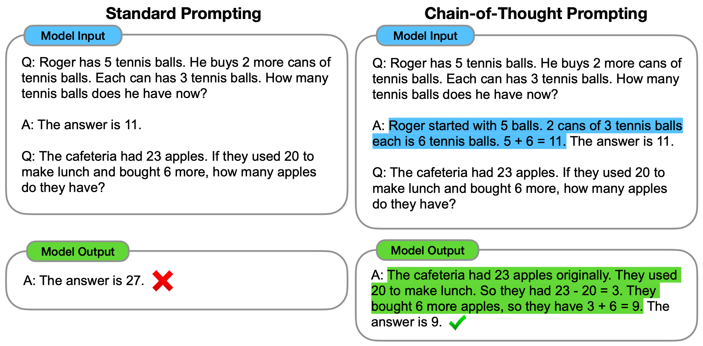
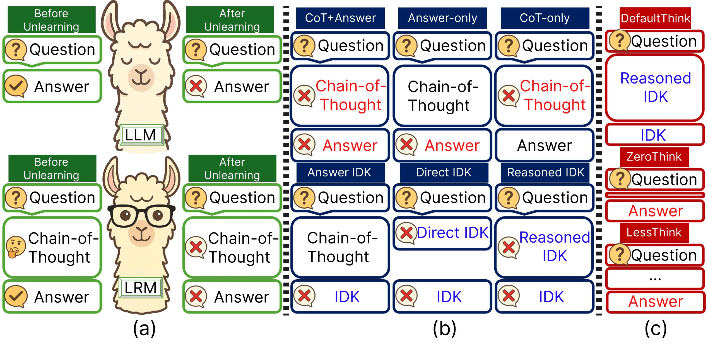

# Awesome LRM Unlearning

<p align="center">
  <a href="https://awesome.re"></a>
  <a href="#papers-by-chronological-order"></a>
  <a href="https://github.com/guts-yang/awesome-lrm-unlearning/commits"></a>
  <a href="https://github.com/guts-yang/awesome-lrm-unlearning/blob/main/LICENSE"></a>
</p>

This repository lists papers, benchmarks, evaluation metrics, and code for machine unlearning in large reasoning models (LRMs) and chain-of-thought (CoT) reasoning. It is a reading list for work on the reasoning trace: the steps a model writes before the final answer, often inside `<think>...</think>`.

The list currently contains **34** papers, **10** benchmarks and evaluation suites, **15** LRM-specific evaluation metrics, and **10** codebases and project pages.

> **Scope.** An entry belongs here when multi-step chain-of-thought traces, thinking trajectories (`<think>...</think>`), or large reasoning models are central to the method or the evaluation. To add a paper, benchmark, or codebase, open an [Issue](../../issues) or send a [Pull Request](CONTRIBUTING.md).

> **Survey.** For a field overview, research timeline, and beginner-friendly reading guide, see the [LRM Unlearning Survey (English)](survey/lrm_unlearning_formulas.html) · [中文版](survey/lrm_unlearning_formulas_CN.html).

## Contents

- [Overview: Why LRM & CoT Unlearning?](#overview-why-lrm--cot-unlearning)
- [News & Highlights](#news--highlights)
- [Papers by Research Taxonomy](#papers-by-research-taxonomy)
  - [1. Parameter-Update LRM & CoT Unlearning](#1-parameter-update-lrm--cot-unlearning)
  - [2. Inference-Time & Training-Free Trajectory Regulation](#2-inference-time--training-free-trajectory-regulation)
  - [3. Benchmarks & Holistic Evaluation Suites](#3-benchmarks--holistic-evaluation-suites)
  - [4. Attacks, Vulnerabilities & Memorization Auditing](#4-attacks-vulnerabilities--memorization-auditing)
  - [5. CoT Faithfulness via Reasoning-Step Unlearning](#5-cot-faithfulness-via-reasoning-step-unlearning)
- [Papers by Chronological Order](#papers-by-chronological-order)
  - [2026](#2026)
  - [2025](#2025)
  - [2024](#2024)
- [Benchmarks & Evaluation Suites](#benchmarks--evaluation-suites)
- [Evaluation Metrics for LRM & CoT Unlearning](#evaluation-metrics-for-lrm--cot-unlearning)
- [Open-Source Frameworks & Portals](#open-source-frameworks--portals)
- [Contributing](#contributing)
- [Citation](#citation)

## Overview: Why LRM & CoT Unlearning?

Standard LLM unlearning scores a map from a question $q$ to an answer $a$. The forget loss and the retain loss are computed on that final answer.

A large reasoning model writes a chain-of-thought before the answer. Models in this setting include OpenAI o1/o3-style systems, DeepSeek-R1 and its distilled variants, QwQ, RLVR-trained checkpoints, and reasoning multimodal LLMs. The trace $c = [c_1, \dots, c_T]$ is usually wrapped in `<think>...</think>`, and the answer $a$ follows it. The prompting setup is the one in [Chain-of-Thought Prompting](https://arxiv.org/abs/2201.11903) ([GitHub](https://github.com/jasonwei20/chain-of-thought-prompting)). Generation then factors as

$$\pi_{\theta}(c, a \mid q) = \pi_{\theta}(c \mid q)\,\pi_{\theta}(a \mid q, c)$$

<table align="center"><tr>
  <td align="center" valign="top" width="50%">
    <a href="https://arxiv.org/abs/2201.11903"></a>
    <br>
    <em>Figure 1 from <a href="https://arxiv.org/abs/2201.11903">Wei et al., Chain-of-Thought Prompting Elicits Reasoning in Large Language Models</a>.</em>
  </td>
  <td align="center" valign="top" width="50%">
    <a href="https://arxiv.org/abs/2505.15214"></a>
    <br>
    <em>Figure 1 from <a href="https://arxiv.org/abs/2505.15214">R-TOFU: Unlearning in Large Reasoning Models</a>.</em>
  </td>
</tr></table>

Methods that edit only the final answer meet three failure modes on these models.

1. **Residual CoT leakage.** Deleting or refusing the answer $a$ can leave sensitive, private, or hazardous content inside the trace $c$. The steps themselves are enough to reconstruct it.
2. **Reasoning collapse.** Large edits to weights or hidden states along a long trace break multi-step deduction. The usual signs are repeated tokens, a missing closing `</think>` tag, and lower accuracy on general STEM sets (`AIME`, `MATH-500`, `GPQA`).
3. **Decoding and reasoning-path bypass.** Constrained decoding (`ZeroThink`, `LessThink`), multi-hop logical paths, and step-by-step prompts can surface knowledge that no longer appears in a normal answer.

<p align="center">
  
</p>

Read the figure in two passes. The top row is the problem setting. A forget query $q$ enters a target model $\pi_{\theta}$. The model writes a reasoning trace $c$, then an answer $a$. Unlearning has to cover both. The outcome boxes are residual CoT leakage, reasoning collapse, and collapse-free unlearning, where the sensitive content is gone and the trace still ends coherently.

The bottom row matches the five tables below, from left to right: parameter updates, inference-time control, benchmarks, attacks and audits, and CoT faithfulness. Keywords in each box are examples from that track.

## News & Highlights

- **`[2026-11-21]`** Expanded after cross-checking arXiv, OpenAlex, Semantic Scholar, ACL Anthology, OpenReview, NeurIPS, ICLR, CVPR, PAKDD, and related paper indexes: [added nine LRM/CoT, agent-trajectory, multi-hop, and reasoning-aware audit works](#papers-by-chronological-order); refreshed formal venue and code links.
- **`[2026-11]`** Initial repository release, with a [taxonomy-structured reading list](#papers-by-research-taxonomy), [chronological tracking](#papers-by-chronological-order), [LRM-specific benchmarks](#benchmarks--evaluation-suites), and [CoT evaluation metrics](#evaluation-metrics-for-lrm--cot-unlearning).
- **`[2026-10]`** [**REDaCT**](#paper-maccoby2026redact) (*Findings of EMNLP 2026*) introduces collapse-free inference-time sentence-level leak detection and corrective embedding injection inside CoT traces.
- **`[2026-09]`** [**GUARD**](#paper-yan2026guard) proposes Guided Answer-Reasoning Distillation for natural safe-exit CoT trajectories and introduces the Natural Forgetting Reasoning Score (`NFRS`).
- **`[2026-07]`** [**CiPO**](#paper-li2026cipo) (*ACL 2026*) formulates causal counterfactual CoT preference optimization for LRMs; [**R-MUSE / RMLLMU-Bench**](#paper-li2025rmuse) (*CVPR 2026*) extends reasoning-preserving unlearning to Multimodal LRMs.
- **`[2025-11]`** Landmark *EMNLP 2025* trio establishes the sub-field: [**R-TOFU**](#paper-yoon2025rtofu) (first LRM unlearning benchmark + `Reasoned IDK`), [**R2MU**](#paper-wang2025r2mu) (reasoning-aware representation misdirection), and [**FUR**](#paper-tutek2025fur) (parametric CoT faithfulness via step unlearning).

---

## Papers by Research Taxonomy

Papers are grouped by the question they study. Each paper has one primary track. A second row, marked `†`, appears when the same paper also belongs elsewhere, for example when it releases both a benchmark and an unlearning algorithm.

### 1. Parameter-Update LRM & CoT Unlearning

Training-time unlearning algorithms that update model weights or hidden-state representations to erase forget-set knowledge from both intermediate Chain-of-Thought (CoT) trajectories and final answers, via representation misdirection, mechanism-guided subspace targeting, counterfactual reasoning preference optimization, or guided reasoning distillation.

| **Paper Title** | **Date** | **Author(s)** | **Venue** | **Method** | **Stage** | **Target Scope** | **Code / Portal** |
| :--- | :---: | :--- | :---: | :---: | :---: | :---: | :---: |
| [Reasoning-Aware Cross-Modal Association Unlearning in Multimodal Large Reasoning Models](https://arxiv.org/abs/2611.06168) | 2026-11 | Li et al. | *arXiv* | `VKCR` | Training-Time & Benchmark | Multimodal CoT + Answer | - |
| [Mitigating Private Data Leakage in LLMs with Whiteout](https://arxiv.org/abs/2610.02418) | 2026-10 | Ha et al. | *arXiv* | `Whiteout` | Training-Time | LRM Reasoning + Private Attribute Association | - |
| [GUARD: Natural Forgetting in Large Reasoning Models via Guided Answer-Reasoning Distillation](https://aclanthology.org/2026.emnlp-main.2334/) | 2026-09 | Yan et al. | *EMNLP 2026 Main* | `GUARD` | Training-Time | CoT + Answer | [](https://github.com/zeyu-Yan/GUARD) |
| [Making LLMs Truly Forget: Deep Unlearning by Searching, Selecting, and Severing Knowledge Paths](https://arxiv.org/abs/2609.34442) | 2026-09 | Wang et al. | *arXiv* | `DUMIC` | Training-Time & Audit | Multi-Hop Reasoning Paths | - |
| [Unlearning Deceptive Behaviors in LLMs with Contrastive Forget Sets](https://arxiv.org/abs/2609.38909) | 2026-09 | Tang & Khanna | *arXiv* | `Pact` | Training-Time | CoT + Context-Conditional Behavior | - |
| [Trajectory Unlearning on LLM-based Agents](https://arxiv.org/abs/2609.33639) | 2026-09 | Shi & Wang | *arXiv* | `GiRPO` | Training-Time | Agent CoT + Action Trajectory | - |
| [FedCoT-VQA: A Federated Learning and Unlearning Framework for Chain-of-Thought Planners in VideoQA](https://arxiv.org/abs/2609.26814) | 2026-09 | Lu et al. | *arXiv* | `FedCoT-VQA / RUM` | Federated Training & Unlearning | Video CoT Planner Trajectory | - |
| [Mechanism-Guided Selective Unlearning for RLVR-Induced Reasoning](https://arxiv.org/abs/2606.19222) | 2026-06 | Zhou et al. | *arXiv* | `MAST` | Training-Time | RLVR Reasoning Trajectories | - |
| [CiPO: Counterfactual Unlearning for Large Reasoning Models through Iterative Preference Optimization](https://aclanthology.org/2026.acl-long.143/) | 2026-04 | Li et al. | *ACL 2026* | `CiPO` | Training-Time | CoT + Answer | [](https://github.com/TerryLee77/CiPO) |
| [Selective Forgetting for Large Reasoning Models](https://doi.org/10.1007/978-981-92-1468-6_28) | 2026-04 | Le et al. | *PAKDD 2026* | `Selective LRM Forgetting` | Training-Time | CoT Segments + Answer | - |
| [Explainable LLM Unlearning Through Reasoning](https://proceedings.iclr.cc/paper_files/paper/2026/hash/1e97fb8a7c9737e9e9f4e0389b25efe8-Abstract-Conference.html) | 2026-03 | Liao et al. | *ICLR 2026* | `TRU` | Training-Time | Reasoning Target + Answer | - |
| [Harmonizing Supervised Fine-Tuning and Reinforcement Learning with Reward-Based Sampling for Continual Machine Unlearning](https://doi.org/10.3390/electronics15040771) | 2026-02 | Lang et al. | *Electronics 2026* | `SRRS` | Training-Time | Full Generation (MU / FE) | [](https://github.com/Langjiaqi/SRRS) |
| [Reasoning or Retrieval? A Study of Answer Attribution on Large Reasoning Models](https://proceedings.iclr.cc/paper_files/paper/2026/file/a7687987dcbbfe70ff5fb658346585df-Paper-Conference.pdf) | 2025-09 | Wang et al. | *ICLR 2026* | `FARL` | Training-Time | LRM Retrieval Shortcuts + CoT Reasoning | [](https://github.com/ZJUWYH/FARL) |
| [Rethinking Unlearning for Large Reasoning Models](https://openreview.net/forum?id=jyzjeLq7K3) | 2025-06 | Wang et al. | *ICML 2025 MUGen Workshop* | `R2MU (Workshop)` | Training-Time | CoT + Answer | [](https://github.com/OPTML-Group/Unlearn-R2MU) |
| [Reasoning Model Unlearning: Forgetting Traces, Not Just Answers, While Preserving Reasoning Skills](https://aclanthology.org/2025.emnlp-main.220/) | 2025-06 | Wang et al. | *EMNLP 2025* | `R2MU` | Training-Time | CoT + Answer | [](https://github.com/OPTML-Group/Unlearn-R2MU) |
| [R-TOFU: Unlearning in Large Reasoning Models](https://aclanthology.org/2025.emnlp-main.265/) † | 2025-05 | Yoon et al. | *EMNLP 2025* | `R-TOFU / Reasoned IDK` | Benchmark & Training-Time | CoT + Answer | [](https://github.com/ssangyeon/R-TOFU) [](https://ai-isl.github.io/r-tofu) |
| [UnStar: Unlearning with Self-Taught Anti-Sample Reasoning for LLMs](https://arxiv.org/abs/2410.17050) | 2024-10 | Sinha et al. | *TMLR 2025* | `UnStar` | Training-Time | Anti-Sample Rationales + Answer | [](https://github.com/MachineUnlearn/UnStar) |

### 2. Inference-Time & Training-Free Trajectory Regulation

Parameter-preserving interventions that monitor, steer, truncate-and-regenerate, or self-correct multi-step reasoning traces during decoding to prevent sensitive CoT disclosure while completely avoiding weight-induced reasoning collapse.

| **Paper Title** | **Date** | **Author(s)** | **Venue** | **Method** | **Stage** | **Target Scope** | **Code / Portal** |
| :--- | :---: | :--- | :---: | :---: | :---: | :---: | :---: |
| [REDaCT: Collapse-Free Unlearning in Large Reasoning Models](https://arxiv.org/abs/2610.12769) | 2026-10 | Maccoby & Wang | *Findings of EMNLP 2026* | `REDaCT` | Inference-Time | CoT + Answer | [](https://github.com/jmaccoby/redact) |
| [Test-Time Unlearning via Sparse Autoencoder](https://arxiv.org/abs/2609.16229) | 2026-09 | Li et al. | *arXiv* | `ARIA` | Inference-Time | CoT + Answer | - |
| [LEMUR: Latent Entropy-aware Multimodal Unlearning via Visual-anchored Reasoning Redirection](https://arxiv.org/abs/2608.11691) | 2026-08 | Zhong et al. | *arXiv* | `LEMUR` | Inference-Time | Multimodal CoT + Answer | - |
| [STaR: Sensitive Trajectory Regulation for Unlearning in Large Reasoning Models](https://ojs.aaai.org/index.php/AAAI/article/download/40818/44779) | 2026-01 | Zhou et al. | *AAAI 2026* | `STaR` | Inference-Time | CoT + Answer | - |
| [Robust LLM Unlearning via Post Judgment and Multi-round Thinking](https://openreview.net/forum?id=GBTUVO9vkj) | 2026-01 | Chen et al. | *ICLR 2026* | `PoRT` | Inference-Time | Multi-Round Thinking + Answer | [](https://github.com/ChnIRuI/PoRT_LLM_Unlearning) |
| [DRAGON: Guard LLM Unlearning in Context via Negative Detection and Reasoning](https://proceedings.iclr.cc/paper_files/paper/2026/file/eaa3d3f05ae14240b7a6a250ce6ddcd7-Paper-Conference.pdf) | 2025-11 | Wang et al. | *ICLR 2026* | `DRAGON` | Inference-Time | In-Context CoT + Answer | - |
| [Towards Reasoning-Preserving Unlearning in Multimodal Large Language Models](https://openaccess.thecvf.com/content/CVPR2026/html/Li_Towards_Reasoning-Preserving_Unlearning_in_Multimodal_Large_Language_Models_CVPR_2026_paper.html) | 2025-11 | Li et al. | *CVPR 2026* | `R-MUSE / RMLLMU-Bench` | Inference-Time & Benchmark | Multimodal CoT + Answer | - |

### 3. Benchmarks & Holistic Evaluation Suites

Dedicated benchmarks and CoT-annotated datasets designed to measure step-level reasoning leakage, answer forgetting, multi-hop reasoning consistency, multimodal reasoning retention, and decoding-variant robustness.

| **Paper Title** | **Date** | **Author(s)** | **Venue** | **Method** | **Stage** | **Target Scope** | **Code / Portal** |
| :--- | :---: | :--- | :---: | :---: | :---: | :---: | :---: |
| [Reasoning-Aware Cross-Modal Association Unlearning in Multimodal Large Reasoning Models](https://arxiv.org/abs/2611.06168) † | 2026-11 | Li et al. | *arXiv* | `VKCR` | Training-Time & Benchmark | Multimodal CoT + Answer | - |
| [K-Bench: A Benchmark for LLM Unlearning in Agentic Deployments](https://arxiv.org/abs/2609.12808) | 2026-09 | Yu et al. | *arXiv* | `K-Bench / K-Score` | Benchmark | CoT + Tools + Retrieval + Summary | - |
| [Making LLMs Truly Forget: Deep Unlearning by Searching, Selecting, and Severing Knowledge Paths](https://arxiv.org/abs/2609.34442) † | 2026-09 | Wang et al. | *arXiv* | `DUMIC` | Training-Time & Audit | Multi-Hop Reasoning Paths | - |
| [Trajectory Unlearning on LLM-based Agents](https://arxiv.org/abs/2609.33639) † | 2026-09 | Shi & Wang | *arXiv* | `GiRPO` | Training-Time | Agent CoT + Action Trajectory | - |
| [FedCoT-VQA: A Federated Learning and Unlearning Framework for Chain-of-Thought Planners in VideoQA](https://arxiv.org/abs/2609.26814) † | 2026-09 | Lu et al. | *arXiv* | `FedCoT-VQA / RUM` | Federated Training & Unlearning | Video CoT Planner Trajectory | - |
| [Leak-Resistant Unlearning: A New Benchmark for Evaluating Multi-Hop Reasoning Consistency and Recovery Robustness](https://aclanthology.org/2026.findings-emnlp.2004/) | 2026-08 | Qian et al. | *Findings of EMNLP 2026* | `Leak-Resistant Bench` | Benchmark | Multi-Hop Reasoning Paths | [](https://leak-resistant.site) |
| [The Unlearning Mirage: A Dynamic Framework for Evaluating LLM Unlearning](https://arxiv.org/abs/2603.11266) | 2026-03 | Shah et al. | *COLM 2025* | `The Unlearning Mirage` | Benchmark / Audit | Multi-Hop Reasoning + CoT Query Decomposition | [](https://sites.google.com/view/unlearningmirage/home) |
| [Towards Reasoning-Preserving Unlearning in Multimodal Large Language Models](https://openaccess.thecvf.com/content/CVPR2026/html/Li_Towards_Reasoning-Preserving_Unlearning_in_Multimodal_Large_Language_Models_CVPR_2026_paper.html) † | 2025-11 | Li et al. | *CVPR 2026* | `R-MUSE / RMLLMU-Bench` | Inference-Time & Benchmark | Multimodal CoT + Answer | - |
| [R-TOFU: Unlearning in Large Reasoning Models](https://aclanthology.org/2025.emnlp-main.265/) | 2025-05 | Yoon et al. | *EMNLP 2025* | `R-TOFU / Reasoned IDK` | Benchmark & Training-Time | CoT + Answer | [](https://github.com/ssangyeon/R-TOFU) [](https://ai-isl.github.io/r-tofu) |

### 4. Attacks, Vulnerabilities & Memorization Auditing

Adversarial studies and construct-validity audits showing how step-by-step reasoning prompts extract superficially erased knowledge, how malicious unlearning requests manipulate LRM rationales, and how parser-split CoT audits can be confounded by template drift.

| **Paper Title** | **Date** | **Author(s)** | **Venue** | **Method** | **Stage** | **Target Scope** | **Code / Portal** |
| :--- | :---: | :--- | :---: | :---: | :---: | :---: | :---: |
| [ShadowBench: Exposing Lexical Anchoring and the Illusion of Forgetting in Large Language Models](https://arxiv.org/abs/2611.15925) | 2026-11 | Maharjan & Liu | *NeurIPS 2026* | `ShadowBench / LELR` | Audit / Evaluation | CoT + Answer | [](https://github.com/sujanW0W/ShadowBench) |
| [K-Bench: A Benchmark for LLM Unlearning in Agentic Deployments](https://arxiv.org/abs/2609.12808) † | 2026-09 | Yu et al. | *arXiv* | `K-Bench / K-Score` | Benchmark | CoT + Tools + Retrieval + Summary | - |
| [Auditing Reasoning-Trace Memorization Claims after Unlearning with Head-Conditioned Canaries](https://arxiv.org/abs/2605.18891) | 2026-05 | Li et al. | *arXiv* | `Canary Prefill Audit` | Audit / Evaluation | CoT + Answer | - |
| [Towards Unveiling Vulnerabilities of Large Reasoning Models in Machine Unlearning](https://doi.org/10.1007/978-981-92-1468-6_36) | 2026-04 | Chen et al. | *PAKDD 2026* | `Bi-Level LRM Unlearning Attack` | Attack | CoT + Answer | - |
| [The Unlearning Mirage: A Dynamic Framework for Evaluating LLM Unlearning](https://arxiv.org/abs/2603.11266) † | 2026-03 | Shah et al. | *COLM 2025* | `The Unlearning Mirage` | Benchmark / Audit | Multi-Hop Reasoning + CoT Query Decomposition | [](https://sites.google.com/view/unlearningmirage/home) |
| [Bits Leaked per Query: Information-Theoretic Bounds on Adversarial Attacks against LLMs](https://arxiv.org/abs/2510.17000) | 2025-10 | Kaneko & Baldwin | *NeurIPS 2025 (Spotlight)* | `Bits Leaked per Query` | Audit / Evaluation | Answer Tokens + Logits + Thinking Process | - |
| [Step-by-Step Reasoning Attack: Revealing 'Erased' Knowledge in Large Language Models](https://arxiv.org/abs/2506.17279) | 2025-06 | Sinha et al. | *arXiv* | `Sleek` | Attack | CoT Extraction | - |

### 5. CoT Faithfulness via Reasoning-Step Unlearning

Mechanistic frameworks that selectively unlearn individual verbalized CoT steps from model parameters to test whether generated reasoning chains faithfully reflect internal parametric computations.

| **Paper Title** | **Date** | **Author(s)** | **Venue** | **Method** | **Stage** | **Target Scope** | **Code / Portal** |
| :--- | :---: | :--- | :---: | :---: | :---: | :---: | :---: |
| [Disentangling the Effects of Unlearning in Measuring Parametric Faithfulness of Chain-of-Thought](https://aclanthology.org/2026.acl-srw.36/) | 2026-07 | Mitsuhashi et al. | *ACL 2026 Student Research Workshop* | `ΔIS / ΔWS` | Training-Time Audit | Individual CoT Steps | - |
| [Measuring Chain of Thought Faithfulness by Unlearning Reasoning Steps](https://arxiv.org/abs/2502.14829) | 2025-02 | Tutek et al. | *EMNLP 2025* | `FUR` | Training-Time Audit | Individual CoT Steps | [](https://github.com/technion-cs-nlp/parametric-faithfulness) |

---

## Papers by Chronological Order

Full entries in reverse chronological order (`YYYY-MM`). Each entry gives the authors, venue, category, evaluated models, a one-line summary, and a code link when one is public.

### 2026

- <a id="paper-maharjan2026shadowbench"></a>[ShadowBench: Exposing Lexical Anchoring and the Illusion of Forgetting in Large Language Models](https://arxiv.org/abs/2611.15925)
  - Author(s): Sujan Maharjan, Lu Liu
  - Date: 2026-11
  - Venue: NeurIPS 2026
  - Category: Attacks & Auditing (`CoT + Answer`)
  - Evaluated Backbones: Qwen3-8B, Llama-3-8B-Instruct
  - Summary: Defines the Latent Entity Leakage Rate (`LELR`) on name-free shadow prompts and shows that gradient-difference and NPO unlearning on Qwen3-8B still reconstruct the forbidden entity inside the reasoning trace.
  - Code: [](https://github.com/sujanW0W/ShadowBench)
- <a id="paper-li2026vkcr"></a>[Reasoning-Aware Cross-Modal Association Unlearning in Multimodal Large Reasoning Models](https://arxiv.org/abs/2611.06168)
  - Author(s): Xinghao Li, Chenchen Tan, Youyang Qu, Shujie Cui, Xingliang Yuan, Cunjian Chen, Chi Liu, Longxiang Gao
  - Date: 2026-11
  - Venue: -
  - Category: Parameter-Update Unlearning / Benchmarks & Evaluation (`Multimodal CoT + Answer`)
  - Evaluated Backbones: R1-Onevision-7B-RL, Qwen2.5-VL-3B-Instruct, LLaVA-1.5-7B
  - Summary: Localizes a parameter edit to a designated visual-to-knowledge association and counterfactually rebinds intermediate reasoning, introducing CLEAR-R and MLLMU-R to measure reasoning leakage, hallucinated reassociation, and retained multimodal reasoning.
  - Code: -
- <a id="paper-maccoby2026redact"></a>[REDaCT: Collapse-Free Unlearning in Large Reasoning Models](https://arxiv.org/abs/2610.12769)
  - Author(s): Joshua Maccoby, Wendy Hui Wang
  - Date: 2026-10
  - Venue: Findings of EMNLP 2026
  - Category: Inference-Time Regulation (`CoT + Answer`)
  - Evaluated Backbones: DeepSeek-R1-Distill-Llama-8B, DeepSeek-R1-Distill-Qwen-7B
  - Summary: Detects forget-set leaks sentence-by-sentence inside CoT traces and injects an offline-learned corrective embedding to regenerate safe continuations with zero reasoning collapse.
  - Code: [](https://github.com/jmaccoby/redact)
- <a id="paper-ha2026whiteout"></a>[Mitigating Private Data Leakage in LLMs with Whiteout](https://arxiv.org/abs/2610.02418)
  - Author(s): Anna Yoo Jeong Ha, Ronik Bhaskar, Haitao Zheng, Ben Y. Zhao
  - Date: 2026-10
  - Venue: -
  - Category: Parameter-Update Unlearning (`LRM Reasoning + Private Attribute Association`)
  - Evaluated Backbones: DeepSeek-R1-Distill-7B, Phi-4-16B, GPT-OSS-20B
  - Summary: Uses precise camouflage-data overwriting for private user-attribute associations and adds synthetic reasoning steps for reasoning models to suppress leakage while preserving reasoning utility.
  - Code: -
- <a id="paper-yu2026kbench"></a>[K-Bench: A Benchmark for LLM Unlearning in Agentic Deployments](https://arxiv.org/abs/2609.12808)
  - Author(s): Guangsheng Yu, Yanna Jiang, Qin Wang, Baihe Ma, Xu Wang
  - Date: 2026-09
  - Venue: -
  - Category: Benchmarks & Evaluation / Attacks & Auditing (`CoT + Tools + Retrieval + Summary`)
  - Evaluated Backbones: Llama-3.1-8B, Mistral-7B, Qwen3
  - Summary: Evaluates deployed ReAct agents across six observable channels and shows that suppressing final answers or CoT alone can leave secrets recoverable through tools, observations, retrieval, or summaries.
  - Code: -
- <a id="paper-yan2026guard"></a>[GUARD: Natural Forgetting in Large Reasoning Models via Guided Answer-Reasoning Distillation](https://aclanthology.org/2026.emnlp-main.2334/)
  - Author(s): Zeyu Yan, Guanghao Zhou, Minghui Qiu, Ming Gao, Cen Chen
  - Date: 2026-09
  - Venue: EMNLP 2026 Main
  - Category: Parameter-Update Unlearning (`CoT + Answer`)
  - Evaluated Backbones: DeepSeek-R1-Distill-Llama-8B, DeepSeek-R1-Distill-Qwen-7B
  - Summary: Converts unsafe or private CoT disclosures into natural safe-exit trajectories via guidance tokens and distills them into model parameters alongside the NFRS replacement-quality metric.
  - Code: [](https://github.com/zeyu-Yan/GUARD)
- <a id="paper-wang2026dumic"></a>[Making LLMs Truly Forget: Deep Unlearning by Searching, Selecting, and Severing Knowledge Paths](https://arxiv.org/abs/2609.34442)
  - Author(s): Jialu Wang, Peizhi Niu, Haoteng Yin, Hans Hao-Hsun Hsu, Pan Li
  - Date: 2026-09
  - Venue: -
  - Category: Parameter-Update Unlearning / Benchmarks & Evaluation (`Multi-Hop Reasoning Paths`)
  - Evaluated Backbones: Qwen3.5-27B, Gemma4-31B-Base
  - Summary: Searches explicit and latent model-supported reasoning paths and applies confidence-aware minimum cuts to sever multi-hop recovery routes while preserving unrelated knowledge.
  - Code: -
- <a id="paper-tang2026pact"></a>[Unlearning Deceptive Behaviors in LLMs with Contrastive Forget Sets](https://arxiv.org/abs/2609.38909)
  - Author(s): Haoran Tang, Rajiv Khanna
  - Date: 2026-09
  - Venue: -
  - Category: Parameter-Update Unlearning (`CoT + Context-Conditional Behavior`)
  - Evaluated Backbones: DeepSeek-R1-Distill-Qwen-32B, QwQ-32B
  - Summary: Builds contrastive forget units from realized deceptions and trains pressure-aware counterfactual reasoning targets that remove deceptive behavior while preserving context use and monitorable CoT traces.
  - Code: -
- <a id="paper-shi2026trajectory"></a>[Trajectory Unlearning on LLM-based Agents](https://arxiv.org/abs/2609.33639)
  - Author(s): Yingdan Shi, Ren Wang
  - Date: 2026-09
  - Venue: -
  - Category: Parameter-Update Unlearning / Benchmarks & Evaluation (`Agent CoT + Action Trajectory`)
  - Evaluated Backbones: Qwen2.5-3B-Instruct, Qwen2.5-7B-Instruct
  - Summary: Defines trajectory-level unlearning for long-horizon agents and uses Group-injected Relative Policy Optimization to penalize undesired reasoning-action trajectories while preserving task utility.
  - Code: -
- <a id="paper-lu2026fedcotvqa"></a>[FedCoT-VQA: A Federated Learning and Unlearning Framework for Chain-of-Thought Planners in VideoQA](https://arxiv.org/abs/2609.26814)
  - Author(s): Rui Lu, Tao Ling, Dan Wang, Qing Li
  - Date: 2026-09
  - Venue: -
  - Category: Parameter-Update Unlearning / Benchmarks & Evaluation (`Video CoT Planner Trajectory`)
  - Evaluated Backbones: CoT Planner for VideoQA
  - Summary: Introduces planner-side partitioning, deletion-ready aggregation, and residual unlearning to remove client influence from both federated parameters and CoT planner reasoning-trace behavior without full retraining.
  - Code: -
- <a id="paper-li2026aria"></a>[Test-Time Unlearning via Sparse Autoencoder](https://arxiv.org/abs/2609.16229)
  - Author(s): Pingzhi Li, Jinhao Duan, Vaishnav Tadiparthi, Nakul Agarwal, Kwonjoon Lee, Ehsan Moradi Pari, Hossein Nourkhiz Mahjoub, Sijia Liu, Tianlong Chen
  - Date: 2026-09
  - Venue: -
  - Category: Inference-Time Regulation (`CoT + Answer`)
  - Evaluated Backbones: DeepSeek-R1-Distill-Qwen-1.5B, Gemma-3-1B-it
  - Summary: Freezes model weights and gates generation with a sparse-autoencoder forget detector, intervening only on triggered states so R-TOFU answers and intermediate CoT traces are suppressed together (`AFE`, `CFE`).
  - Code: -
- <a id="paper-zhong2026lemur"></a>[LEMUR: Latent Entropy-aware Multimodal Unlearning via Visual-anchored Reasoning Redirection](https://arxiv.org/abs/2608.11691)
  - Author(s): Xinhao Zhong, Yuxia Qiao, Junhao Li, Hao Fang, Yi Sun, Bin Chen
  - Date: 2026-08
  - Venue: -
  - Category: Inference-Time Regulation (`Multimodal CoT + Answer`)
  - Evaluated Backbones: R1-Onevision-7B, Vision-R1-7B
  - Summary: Uses token-level entropy and forbidden-token mass to delimit sensitive spans inside RL-trained multimodal reasoning traces, then redirects those spans with visual-anchor latent injection while leaving weights frozen.
  - Code: -
- <a id="paper-qian2026leakresistant"></a>[Leak-Resistant Unlearning: A New Benchmark for Evaluating Multi-Hop Reasoning Consistency and Recovery Robustness](https://aclanthology.org/2026.findings-emnlp.2004/)
  - Author(s): Haoting Qian, Qingjie Zhang, Zhicong Huang, Cheng Hong, Han Qiu
  - Date: 2026-08
  - Venue: Findings of EMNLP 2026
  - Category: Benchmarks & Evaluation (`Multi-Hop Reasoning Paths`)
  - Evaluated Backbones: Llama-3-8B, Qwen2.5-7B, Mistral-7B
  - Summary: Evaluates whether unlearned knowledge remains recoverable across six logic-guided multi-hop reasoning structures combined with prompt-level and parameter-level recovery attacks.
  - Code: [](https://leak-resistant.site)
- <a id="paper-mitsuhashi2026deltacot"></a>[Disentangling the Effects of Unlearning in Measuring Parametric Faithfulness of Chain-of-Thought](https://aclanthology.org/2026.acl-srw.36/)
  - Author(s): Ryo Mitsuhashi, Gaku Morio, Ayana Niwa, Masahiro Kaneko, Kentaro Inui, Terufumi Morishita, Yuta Koreeda, Yasuhiro Sogawa
  - Date: 2026-07
  - Venue: ACL 2026 Student Research Workshop
  - Category: CoT Faithfulness (`Individual CoT Steps`)
  - Evaluated Backbones: Llama-3-8B, Llama-3-70B, Llama-3.2-3B
  - Summary: Adds irrelevant-step and word-shuffle controls on top of step-level CoT unlearning, and defines `ΔIS` and `ΔWS` so parametric faithfulness scores subtract artifacts of the unlearning update itself.
  - Code: -
- <a id="paper-zhou2026mast"></a>[Mechanism-Guided Selective Unlearning for RLVR-Induced Reasoning](https://arxiv.org/abs/2606.19222)
  - Author(s): Chenyu Zhou, Qiliang Jiang, Shuning Wu, Xu Zhou
  - Date: 2026-06
  - Venue: -
  - Category: Parameter-Update Unlearning (`RLVR Reasoning Trajectories`)
  - Evaluated Backbones: Qwen2.5-Math-1.5B, Qwen3-1.7B-Base
  - Summary: Identifies directional mismatch between SFT and RLVR reasoning updates, ranking attention-projection tensors by off-principal energy and forget-gradient coupling to unlearn target math reasoning without collapsing retain skills.
  - Code: -
- <a id="paper-li2026canaryaudit"></a>[Auditing Reasoning-Trace Memorization Claims after Unlearning with Head-Conditioned Canaries](https://arxiv.org/abs/2605.18891)
  - Author(s): Yanhang Li, Zhichao Fan, Zexin Zhuang
  - Date: 2026-05
  - Venue: -
  - Category: Attacks & Auditing (`CoT + Answer`)
  - Evaluated Backbones: DeepSeek-R1-Distill-Qwen-7B, DeepSeek-R1-Distill-Llama-8B
  - Summary: Audits the parser-split CoT bypass gap on distilled LRMs using six-token canary heads, showing static tag-splitting conflates weight retention with template echo and format drift, and proposes decode-time prefill swaps plus teacher-forced scoring.
  - Code: -
- <a id="paper-li2026cipo"></a>[CiPO: Counterfactual Unlearning for Large Reasoning Models through Iterative Preference Optimization](https://aclanthology.org/2026.acl-long.143/)
  - Author(s): Junyi Li, Yongqiang Chen, Ningning Ding
  - Date: 2026-04
  - Venue: ACL 2026
  - Category: Parameter-Update Unlearning (`CoT + Answer`)
  - Evaluated Backbones: DeepSeek-R1-Distill-Llama-8B
  - Summary: Formulates LRM unlearning via a causal graph and iteratively pairs self-generated counterfactual CoT-answer trajectories against online-sampled leaking traces using reference-free SimPO.
  - Code: [](https://github.com/TerryLee77/CiPO)
- <a id="paper-le2026selective"></a>[Selective Forgetting for Large Reasoning Models](https://doi.org/10.1007/978-981-92-1468-6_28)
  - Author(s): Tuan Le, Wei Qian, Mengdi Huai
  - Date: 2026-04
  - Venue: PAKDD 2026
  - Category: Parameter-Update Unlearning (`CoT Segments + Answer`)
  - Evaluated Backbones: DeepSeek-R1-Distill-Llama-8B, DeepSeek-R1-Distill-Qwen-7B
  - Summary: Uses RAG-assisted multi-LLM analysis to pinpoint forget-relevant segments within CoT traces, replacing them with logically consistent benign placeholders under a feature-replacement unlearning loss.
  - Code: -
- <a id="paper-chen2026vulnerabilities"></a>[Towards Unveiling Vulnerabilities of Large Reasoning Models in Machine Unlearning](https://doi.org/10.1007/978-981-92-1468-6_36)
  - Author(s): Aobo Chen, Chenxu Zhao, Chenglin Miao, Mengdi Huai
  - Date: 2026-04
  - Venue: PAKDD 2026
  - Category: Attacks & Auditing (`CoT + Answer`)
  - Evaluated Backbones: DeepSeek-R1-Distill-Llama-8B, DeepSeek-R1-Distill-Qwen-7B
  - Summary: Introduces white-box and black-box bi-level malicious unlearning requests that force unlearned LRMs to output incorrect answers supported by coherent, deceptive reasoning traces.
  - Code: -
- <a id="paper-shah2026mirage"></a>[The Unlearning Mirage: A Dynamic Framework for Evaluating LLM Unlearning](https://arxiv.org/abs/2603.11266)
  - Author(s): Raj Sanjay Shah, Jing Huang, Keerthiram Murugesan, Nathalie Baracaldo, Diyi Yang
  - Date: 2026-03
  - Venue: COLM 2025
  - Category: Benchmarks & Evaluation / Attacks & Auditing (`Multi-Hop Reasoning + CoT Query Decomposition`)
  - Evaluated Backbones: Llama-3-8B, Mistral-7B
  - Summary: Dynamically generates semantically equivalent and multi-hop probes from pre-unlearning knowledge to expose recovery paths missed by static answer-level unlearning benchmarks.
  - Code: [](https://sites.google.com/view/unlearningmirage/home)
- <a id="paper-liao2026tru"></a>[Explainable LLM Unlearning Through Reasoning](https://proceedings.iclr.cc/paper_files/paper/2026/hash/1e97fb8a7c9737e9e9f4e0389b25efe8-Abstract-Conference.html)
  - Author(s): Junfeng Liao, Qizhou Wang, Shanshan Ye, Xin Yu, Ling Chen, Zhen Fang
  - Date: 2026-03
  - Venue: ICLR 2026
  - Category: Parameter-Update Unlearning (`Reasoning Target + Answer`)
  - Evaluated Backbones: Llama-3-8B-Instruct, Qwen2.5-7B-Instruct
  - Summary: Constructs explicit reasoning-based unlearning targets specifying both unlearning scope and post-unlearning behavior, combining supervised reasoning loss with gradient ascent for explainable and attack-resilient forgetting.
  - Code: -
- <a id="paper-lang2026srrs"></a>[Harmonizing Supervised Fine-Tuning and Reinforcement Learning with Reward-Based Sampling for Continual Machine Unlearning](https://doi.org/10.3390/electronics15040771)
  - Author(s): Jiaqi Lang, Jiahao Zhao, Linjing Li, Daniel Dajun Zeng
  - Date: 2026-02
  - Venue: Electronics 2026
  - Category: Parameter-Update Unlearning (`Full Generation (MU / FE)`)
  - Evaluated Backbones: DeepSeek-R1-Distill-Llama-8B, Qwen3-4B-Instruct
  - Summary: Routes continual forget samples between gradient-ascent SFT and GRPO by reward. On ten sequential R-TOFU tasks with DeepSeek-R1-Distill-Llama-8B, forgetting is scored with answer-level Model Utility (`MU`) and Forgetting Efficacy (`FE`) over full generations.
  - Code: [](https://github.com/Langjiaqi/SRRS)
- <a id="paper-zhou2026star"></a>[STaR: Sensitive Trajectory Regulation for Unlearning in Large Reasoning Models](https://ojs.aaai.org/index.php/AAAI/article/download/40818/44779)
  - Author(s): Jingjing Zhou, Gaoxiang Cong, Li Su, Liang Li
  - Date: 2026-01
  - Venue: AAAI 2026
  - Category: Inference-Time Regulation (`CoT + Answer`)
  - Evaluated Backbones: DeepSeek-R1-Distill-Llama-8B, DeepSeek-R1-Distill-Qwen-7B
  - Summary: Parameter-free inference-time framework combining semantic sensitivity detection, global safety prompt prefixes, trajectory-aware suppression, and token-level adaptive filtering across diverse decoding modes.
  - Code: -
- <a id="paper-chen2026port"></a>[Robust LLM Unlearning via Post Judgment and Multi-round Thinking](https://openreview.net/forum?id=GBTUVO9vkj)
  - Author(s): Xinrui Chen, Xu Cao, Jianhao Zhang, Pinlong Zhao, Di Gao, Ou Wu
  - Date: 2026-01
  - Venue: ICLR 2026
  - Category: Inference-Time Regulation (`Multi-Round Thinking + Answer`)
  - Evaluated Backbones: Llama-3-8B-Instruct, Qwen2.5-7B-Instruct
  - Summary: Combines dynamic few-shot query cleaning, joint question-answer post-judgment, and selective multi-round thinking self-correction to defend deployed unlearning systems against prefix and composite reasoning attacks.
  - Code: [](https://github.com/ChnIRuI/PoRT_LLM_Unlearning)

### 2025

- <a id="paper-wang2025dragon"></a>[DRAGON: Guard LLM Unlearning in Context via Negative Detection and Reasoning](https://proceedings.iclr.cc/paper_files/paper/2026/file/eaa3d3f05ae14240b7a6a250ce6ddcd7-Paper-Conference.pdf)
  - Author(s): Yaxuan Wang, Chris Yuhao Liu, Quan Liu, Jinlong Pang, Wei Wei, Yujia Bao, Yang Liu
  - Date: 2025-11
  - Venue: ICLR 2026
  - Category: Inference-Time Regulation (`In-Context CoT + Answer`)
  - Evaluated Backbones: Llama-3-8B-Instruct, Mistral-7B-Instruct
  - Summary: Routes detected forget-worthy prompts without retain data through a dedicated Chain-of-Thought guard model that generates stepwise reasoning instructions for safe in-context unlearning and continual updates.
  - Code: -
- <a id="paper-li2025rmuse"></a>[Towards Reasoning-Preserving Unlearning in Multimodal Large Language Models](https://openaccess.thecvf.com/content/CVPR2026/html/Li_Towards_Reasoning-Preserving_Unlearning_in_Multimodal_Large_Language_Models_CVPR_2026_paper.html)
  - Author(s): Hongji Li, Junchi Yao, Manjiang Yu, Priyanka Singh, Xue Li, Di Wang, Lijie Hu
  - Date: 2025-11
  - Venue: CVPR 2026
  - Category: Inference-Time Regulation / Benchmarks & Evaluation (`Multimodal CoT + Answer`)
  - Evaluated Backbones: QvQ-72B-Preview, InternVL2.5-MPO
  - Summary: Introduces RMLLMU-Bench for Reasoning MLLMs alongside R-MUSE, a training-free subspace steering method that suppresses visual-textual CoT leakage while protecting a Reasoning Retain Subspace.
  - Code: -
- <a id="paper-kaneko2025bitsleaked"></a>[Bits Leaked per Query: Information-Theoretic Bounds on Adversarial Attacks against LLMs](https://arxiv.org/abs/2510.17000)
  - Author(s): Masahiro Kaneko, Timothy Baldwin
  - Date: 2025-10
  - Venue: NeurIPS 2025 (Spotlight)
  - Category: Attacks & Auditing (`Answer Tokens + Logits + Thinking Process`)
  - Evaluated Backbones: DeepSeek-R1, OLMo-2, Llama-4
  - Summary: Defines leaked bits per query and quantifies how exposing logits or full thinking processes lowers the query complexity of attacks that recover information intended to be removed by unlearning.
  - Code: -
- <a id="paper-wang2025farl"></a>[Reasoning or Retrieval? A Study of Answer Attribution on Large Reasoning Models](https://proceedings.iclr.cc/paper_files/paper/2026/file/a7687987dcbbfe70ff5fb658346585df-Paper-Conference.pdf)
  - Author(s): Yuhui Wang, Changjiang Li, Guangke Chen, Jiacheng Liang, Ting Wang
  - Date: 2025-09
  - Venue: ICLR 2026
  - Category: Parameter-Update Unlearning (`LRM Retrieval Shortcuts + CoT Reasoning`)
  - Evaluated Backbones: DeepSeek-R1-Distill, Qwen3
  - Summary: Combines memory unlearning with reinforcement learning to suppress retrieval shortcuts that compete with chain-of-thought reasoning and improve reasoning-dominant answer attribution.
  - Code: [](https://github.com/ZJUWYH/FARL)
- <a id="paper-wang2025rethinking"></a>[Rethinking Unlearning for Large Reasoning Models](https://openreview.net/forum?id=jyzjeLq7K3)
  - Author(s): Changsheng Wang, Chongyu Fan, Yihua Zhang, Jinghan Jia, Dennis Wei, Parikshit Ram, Nathalie Baracaldo, Sijia Liu
  - Date: 2025-06
  - Venue: ICML 2025 MUGen Workshop
  - Category: Parameter-Update Unlearning (`CoT + Answer`)
  - Evaluated Backbones: DeepSeek-R1-Distill-LLaMA-8B, DeepSeek-R1-Distill-Qwen-14B
  - Summary: Workshop formulation exposing persistent sensitive information leakage inside LRM thinking trajectories under conventional LLM unlearning and motivating reasoning-aware representation misdirection.
  - Code: [](https://github.com/OPTML-Group/Unlearn-R2MU)
- <a id="paper-wang2025r2mu"></a>[Reasoning Model Unlearning: Forgetting Traces, Not Just Answers, While Preserving Reasoning Skills](https://aclanthology.org/2025.emnlp-main.220/)
  - Author(s): Changsheng Wang, Chongyu Fan, Yihua Zhang, Jinghan Jia, Dennis Wei, Parikshit Ram, Nathalie Baracaldo, Sijia Liu
  - Date: 2025-06
  - Venue: EMNLP 2025
  - Category: Parameter-Update Unlearning (`CoT + Answer`)
  - Evaluated Backbones: DeepSeek-R1-Distill-LLaMA-8B, DeepSeek-R1-Distill-Qwen-14B
  - Summary: First systematic study of LRM unlearning; proposes an 'unthinking' representation misdirection loss over elicited CoT segments paired with LIMO CoT representation alignment to preserve reasoning ability.
  - Code: [](https://github.com/OPTML-Group/Unlearn-R2MU)
- <a id="paper-sinha2025sleek"></a>[Step-by-Step Reasoning Attack: Revealing 'Erased' Knowledge in Large Language Models](https://arxiv.org/abs/2506.17279)
  - Author(s): Yash Sinha, Manit Baser, Murari Mandal, Dinil Mon Divakaran, Mohan Kankanhalli
  - Date: 2025-06
  - Venue: -
  - Category: Attacks & Auditing (`CoT Extraction`)
  - Evaluated Backbones: Llama-2-7B, Mistral-7B
  - Summary: Demonstrates that step-by-step CoT reasoning acts as a black-box backdoor (`Sleek`) to reconstruct superficially erased facts across direct, implied, and indirect multi-step prompts.
  - Code: -
- <a id="paper-yoon2025rtofu"></a>[R-TOFU: Unlearning in Large Reasoning Models](https://aclanthology.org/2025.emnlp-main.265/)
  - Author(s): Sangyeon Yoon, Wonje Jeung, Albert No
  - Date: 2025-05
  - Venue: EMNLP 2025
  - Category: Benchmarks & Evaluation / Parameter-Update Unlearning (`CoT + Answer`)
  - Evaluated Backbones: DeepSeek-R1-Distill-Llama-8B, DeepSeek-R1-Distill-Qwen-7B, DeepSeek-R1-Distill-Qwen-14B
  - Summary: Establishes the first LRM unlearning benchmark with aligned CoT annotations and step-wise metrics (`CFE`, `AFE`), proposes `Reasoned IDK` preference tuning, and uncovers `ZeroThink`/`LessThink` decoding leakage.
  - Code: [](https://github.com/ssangyeon/R-TOFU) [](https://ai-isl.github.io/r-tofu)
- <a id="paper-tutek2025fur"></a>[Measuring Chain of Thought Faithfulness by Unlearning Reasoning Steps](https://arxiv.org/abs/2502.14829)
  - Author(s): Martin Tutek, Fateme Hashemi Chaleshtori, Ana Marasovic, Yonatan Belinkov
  - Date: 2025-02
  - Venue: EMNLP 2025
  - Category: CoT Faithfulness (`Individual CoT Steps`)
  - Evaluated Backbones: Llama-3-8B-Instruct, Mistral-7B-Instruct, OLMo-7B-Instruct, Zephyr-7B
  - Summary: Erases parametric knowledge encoded in individual CoT steps via KL-regularized NPO (`FUR`) and measures resulting prediction shifts (`ff-hard`, `ff-soft`) to test parametric CoT faithfulness.
  - Code: [](https://github.com/technion-cs-nlp/parametric-faithfulness)

### 2024

- <a id="paper-sinha2024unstar"></a>[UnStar: Unlearning with Self-Taught Anti-Sample Reasoning for LLMs](https://arxiv.org/abs/2410.17050)
  - Author(s): Yash Sinha, Murari Mandal, Mohan Kankanhalli
  - Date: 2024-10
  - Venue: TMLR 2025
  - Category: Parameter-Update Unlearning (`Anti-Sample Rationales + Answer`)
  - Evaluated Backbones: Llama-2-7B, Mistral-7B
  - Summary: Pioneers self-taught anti-sample reasoning—generating falsified answers backed by misleading step-by-step rationales—to selectively reverse target parametric associations without harming neighboring facts.
  - Code: [](https://github.com/MachineUnlearn/UnStar)

---

## Benchmarks & Evaluation Suites

Datasets and suites for trace leakage, answer erasure, multi-hop consistency, multimodal retention, and decoding variants.

| **Benchmark / Dataset** | **Category** | **Scale & Splits** | **Modality** | **Evaluation Focus** | **Links** |
| :--- | :--- | :--- | :---: | :--- | :---: |
| **R-TOFU (Reasoning-TOFU)** | Dedicated LRM Unlearning | 4,000 QA + Aligned CoTs (200 fictitious authors; forget01 / forget05 / forget10) | Text (CoT + Answer) | Entity privacy unlearning across intermediate CoT steps and final answers, plus ZeroThink/LessThink decoding robustness. | [[Resource]](https://ai-isl.github.io/r-tofu) [[Paper]](https://arxiv.org/abs/2505.15214) |
| **RMLLMU-Bench** | Dedicated Multimodal LRM Unlearning | Multi-split Forget / Retain / Celebrity & General VQA with Visual CoTs | Image + Text (Multimodal CoT) | Jointly evaluates visual-textual reasoning leakage (`RIL`), answer forgetting, and general multimodal reasoning retention. | [[Paper]](https://arxiv.org/abs/2512.17911) |
| **Leak-Resistant Unlearning Benchmark** | Multi-Hop Reasoning & Recovery | 6 logic-guided multi-hop reasoning structures across 2 curated datasets | Text (Multi-Hop Reasoning) | Measures indirect knowledge leakage via multi-hop logical paths and post-unlearning prompt/parameter recovery attacks. | [[Resource]](https://leak-resistant.site) [[Paper]](https://arxiv.org/abs/2608.04519) |
| **RETURN (Real-World LRM Memorization Split)** | Real-World LRM Privacy Unlearning | 260 deeply memorized public-figure QA pairs (50% Forget / 50% Retain) | Text (Native LRM CoT + Answer) | Evaluates unlearning of naturally memorized real-world PII in native DeepSeek-R1-Distill CoT trajectories rather than synthetic traces. | [[Resource]](https://github.com/TerryLee77/CiPO) [[Paper]](https://arxiv.org/abs/2604.15847) |
| **STAR-1 Harmful-Intent LRM Split** | Safety & Harmful Rationale Unlearning | Curated harmful-intent prompts with safety-aligned vs. unsafe reasoning traces | Text (Safety CoT + Refusal) | Tests whether LRM unlearning replaces unsafe intermediate rationales with coherent safe-exit trajectories without degenerating. | [[Resource]](https://github.com/zeyu-Yan/GUARD) [[Paper]](https://arxiv.org/abs/2609.21677) |
| **WMDP + StrongReject / WildJailbreak / JBB-Behaviors** | Hazardous Knowledge & Safety Suites (Adapted to LRMs) | 3,668 bio/cyber/chem MCQs (WMDP) + adversarial safety prompts | Text (CoT Trace + Answer) | Adopted in R2MU to measure hazardous reasoning trace unlearning (`RT-UA`) alongside final answer suppression (`FA-UA`). | [[Resource]](https://github.com/OPTML-Group/Unlearn-R2MU) [[Paper]](https://arxiv.org/abs/2506.12963) |
| **AIME 2024 / MATH-500 / GPQA Diamond / GSM8K + LIMO** | General Reasoning Preservation & Supervision Suites | Competition math, graduate-level STEM QA, and high-quality CoT supervision triplets | Text (Multi-Step STEM CoT) | Standard utility suites verifying that LRM unlearning does not induce reasoning collapse or degrade test-time scaling competence. | [[Resource]](https://github.com/OPTML-Group/Unlearn-R2MU) [[Paper]](https://arxiv.org/abs/2506.12963) |
| **ShadowBench / SB-Unlearning** | Latent Association & CoT Leakage Audit | Entity-anonymized shadow prompts with forget / retain controls | Text (CoT + Answer) | Tests whether unlearned models reconstruct forbidden entities from name-free lexical shadow cues and reasoning traces. | [[Resource]](https://huggingface.co/datasets/shadow-bench/SB-unlearning) [[Paper]](https://arxiv.org/abs/2611.15925) |
| **K-Bench** | Agentic Deployment Unlearning | Six observable ReAct channels across parametric, prompt, and retrieval substrates | Text (Agent CoT + Tools + Retrieval) | Measures whether secrets migrate from final answers or CoT into tool calls, tool observations, retrieval, or summaries while preserving agent usability. | [[Paper]](https://arxiv.org/abs/2609.12808) |
| **The Unlearning Mirage Dynamic Evaluation** | Dynamic Multi-Hop Recovery Evaluation | Automatically generated single-hop, paraphrase, entity-alias, and multi-hop probes | Text (Multi-Hop Reasoning) | Stress-tests static unlearning claims by constructing probes from pre-unlearning model knowledge and measuring alternate reasoning-path recovery. | [[Resource]](https://sites.google.com/view/unlearningmirage/home) [[Paper]](https://arxiv.org/abs/2603.11266) |

---

## Evaluation Metrics for LRM & CoT Unlearning

These metrics record four things: leakage inside the reasoning trace, erasure of the final answer, whether multi-step reasoning still finishes cleanly, and whether a change in decoding brings the forgotten content back.

### Reasoning-Trace Forgetting Metrics

| **Metric** | **Target Granularity** | **Mechanism / Definition** | **Primary Reference** |
| :--- | :---: | :--- | :--- |
| **CFE (CoT Forgetting Efficacy)** | Step-wise CoT Trace | Aggregates step-level ROUGE recall, step-level cosine similarity, and LLM-as-Judge entailment between generated CoT steps and ground-truth forget facts (higher = stronger trace forgetting). | R-TOFU (Yoon et al., 2025) |
| **RT-UA / CoT-UA (Reasoning Trace Unlearning Accuracy)** | Full CoT Trajectory | Fraction or judge-scored rate at which intermediate `<think>...</think>` trajectories still disclose sensitive or hazardous forget-set knowledge (lower = better forgetting). | R2MU (Wang et al., 2025); CiPO (Li et al., 2026) |
| **RIL (Reasoning Information Leakage)** | Multimodal CoT Process | Quantifies residual target entity/attribute disclosure specifically inside intermediate multimodal reasoning steps on RMLLMU-Bench. | R-MUSE (Li et al., 2025) |
| **LELR (Latent Entity Leakage Rate)** | Name-Free CoT Shadow Prompt | Fraction of anonymized shadow-prompt traces that reconstruct identifying tokens of the forgotten entity; lower indicates deeper latent forgetting. | ShadowBench (Maharjan et al., 2026) |
| **K-Score** | Agent Deployment Channel Set | Source-specific forgetting score that credits low leakage only when the deployed agent remains usable across CoT, tools, retrieval, answer, and summary channels. | K-Bench (Yu et al., 2026) |

### Answer-Level Forgetting Metrics

| **Metric** | **Target Granularity** | **Mechanism / Definition** | **Primary Reference** |
| :--- | :---: | :--- | :--- |
| **AFE (Answer Forgetting Efficacy)** | Final Answer Span | Complements ROUGE, token probability, truth ratio, and LLM-as-Judge checks on the post-`</think>` final answer span (higher = stronger answer forgetting). | R-TOFU (Yoon et al., 2025) |
| **FA-UA / ForgetACC (Final Answer Unlearning Accuracy)** | Final Answer Span | Task accuracy or factual recall on forget-set queries measured strictly on the final output after reasoning terminates (lower = better forgetting). | R2MU (Wang et al., 2025); CiPO (Li et al., 2026) |

### Reasoning Preservation & Structural Integrity Metrics

| **Metric** | **Target Granularity** | **Mechanism / Definition** | **Primary Reference** |
| :--- | :---: | :--- | :--- |
| **RA (Reasoning Ability)** | General STEM Reasoning | Pass@1 accuracy across held-out multi-step reasoning benchmarks (`AIME 2024`, `MATH-500`, `GPQA Diamond`, `GSM8K`) post-unlearning (higher = better retention). | R2MU (Wang et al., 2025) |
| **Reasoning Collapse Rate / Closing-Delimiter Rate** | CoT Structural Validity | Proportion of responses that degenerate into infinite token loops, gibberish, or fail to emit the closing `</think>` delimiter before token budget exhaustion (0% = collapse-free). | REDaCT (Maccoby & Wang, 2026) |
| **NFRS (Natural Forgetting Reasoning Score)** | Post-Forgetting Trajectory Quality | Evaluates structural boundary stability, fluency, and absence of hallucinated unsupported substitutes in safe-exit CoT trajectories. | GUARD (Yan et al., 2026) |

### Decoding Robustness, Privacy & Faithfulness Audit Metrics

| **Metric** | **Target Granularity** | **Mechanism / Definition** | **Primary Reference** |
| :--- | :---: | :--- | :--- |
| **ZeroThink / LessThink Decoding Leakage** | Constrained-Thinking Decoding | Measures forgotten knowledge resurgence when bypassing (`<think></think>`) or truncating the thinking phase at inference time. | R-TOFU (Yoon et al., 2025) |
| **MCS & Multi-Granularity MIA** | Cross-Decoding & Trace/Answer Privacy | Multi-Decoding Consistency Score (`MCS`) across sampling/thinking modes paired with Membership Inference Attacks at both CoT-chain and answer levels. | STaR (Zhou et al., 2026) |
| **Decode-Time Prefill Swap & Teacher-Forced Canary Probe** | Parser-Split Audit Validity | Pairs fixed non-canary thinking prefills with decoding-free teacher-forced continuation scoring to separate true weight memorization from template echo and format drift. | Canary Audit (Li et al., 2026) |
| **ff-hard & ff-soft (Parametric CoT Faithfulness)** | Individual CoT Step | Measures prediction label flip (`ff-hard`) and target-answer probability drop (`ff-soft`) after unlearning a single CoT step from model parameters. | FUR (Tutek et al., 2025) |
| **Bits Leaked per Query** | Observable Signal per Attack Query | Mutual information between exposed model signals, including answers, logits, or thinking traces, and successful recovery of a hidden target; lower indicates a more expensive attack surface. | Bits Leaked per Query (Kaneko & Baldwin, 2025) |

---

## Open-Source Frameworks & Portals

Public code and project pages for methods and benchmarks in this list.

- **[Unlearn-R2MU](https://github.com/OPTML-Group/Unlearn-R2MU)** (EMNLP 2025) [](https://github.com/OPTML-Group/Unlearn-R2MU)
  - Official codebase for Reasoning-aware Representation Misdirection for Unlearning (`R2MU`) on DeepSeek-R1-Distill models across WMDP and safety/math suites.
- **[R-TOFU Benchmark Suite](https://ai-isl.github.io/r-tofu)** (EMNLP 2025) [](https://ai-isl.github.io/r-tofu)
  - Benchmark portal, CoT-annotated fictitious-author splits, step-wise `CFE`/`AFE` evaluators, and `Reasoned IDK` / `ZeroThink` / `LessThink` protocols.
- **[CiPO](https://github.com/TerryLee77/CiPO)** (ACL 2026) [](https://github.com/TerryLee77/CiPO)
  - Counterfactual CoT generator and online iterative SimPO unlearning pipeline evaluated on R-TOFU and real-world RETURN splits.
- **[REDaCT](https://github.com/jmaccoby/redact)** (Findings of EMNLP 2026) [](https://github.com/jmaccoby/redact)
  - Collapse-free inference-time sentence-level RoBERTa leak detector and corrective embedding optimization for DeepSeek-R1-Distill LRMs.
- **[GUARD](https://github.com/zeyu-Yan/GUARD)** (Preprint 2026) [](https://github.com/zeyu-Yan/GUARD)
  - Guided Answer-Reasoning Distillation training pipeline and Natural Forgetting Reasoning Score (`NFRS`) evaluation suite.
- **[PoRT](https://github.com/ChnIRuI/PoRT_LLM_Unlearning)** (ICLR 2026) [](https://github.com/ChnIRuI/PoRT_LLM_Unlearning)
  - Post-judgment and selective multi-round thinking (`SMT`) framework for attack-resilient inference-time unlearning.
- **[Parametric-Faithfulness (FUR)](https://github.com/technion-cs-nlp/parametric-faithfulness)** (EMNLP 2025) [](https://github.com/technion-cs-nlp/parametric-faithfulness)
  - Step-level CoT unlearning pipeline (`FUR`) and `ff-hard`/`ff-soft` parametric faithfulness evaluators.
- **[UnStar](https://github.com/MachineUnlearn/UnStar)** (TMLR 2025) [](https://github.com/MachineUnlearn/UnStar)
  - Self-taught anti-sample rationale generation and targeted association unlearning implementation.
- **[ShadowBench](https://github.com/sujanW0W/ShadowBench)** (NeurIPS 2026) [](https://github.com/sujanW0W/ShadowBench)
  - Latent association audit implementation and SB-Unlearning shadow-prompt dataset for testing CoT reconstruction after lexical unlearning.
- **[The Unlearning Mirage](https://sites.google.com/view/unlearningmirage/home)** (COLM 2025) [](https://sites.google.com/view/unlearningmirage/home)
  - Dynamic probe-generation package for evaluating multi-hop and alias-based knowledge recovery after LLM unlearning.

---

## Contributing

To add an entry, follow [CONTRIBUTING.md](CONTRIBUTING.md), or open a submission with the [issue template](../../issues/new/choose).

- **Inclusion criteria:**
  1. The work studies machine unlearning, selective forgetting, an unlearning attack or audit, or an unlearning benchmark, and the chain-of-thought trace, the `<think>...</think>` trajectory, or a large reasoning model (including reasoning multimodal LLMs and RLVR models) is part of the method or the evaluation.
  2. Papers that unlearn only the final answer, with no intervention on the reasoning trace, no leakage analysis of that trace, and no LRM evaluation, belong in the general lists [chrisliu298/awesome-llm-unlearning](https://github.com/chrisliu298/awesome-llm-unlearning) and [tamlhp/awesome-machine-unlearning](https://github.com/tamlhp/awesome-machine-unlearning).
- **Update steps:**
  ```bash
  # 1. Add or update entries in data/papers.json or data/benchmarks_metrics.json
  # 2. Rebuild README.md and check that it matches the data
  python3 scripts/build_readme.py
  python3 scripts/validate_data.py --check-readme
  ```

## Citation

This repository is a curated reading list for machine unlearning in large reasoning models and chain-of-thought reasoning. There is no paper to cite for the list itself. If the list helps, [star the repository](https://github.com/guts-yang/awesome-lrm-unlearning). If your work uses a listed result, cite that paper, benchmark, or codebase on its own.
